# IW8 Radiant

IW8 Radiant (code name IW8r) is a Radiant-style map editor for Call of Duty: Modern Warfare (2019). Build your own
multiplayer maps or open the game's stock maps, Warzone included, and change them. The editor previews maps with the
game's lighting, builds them into the game's own zone files and starts them in the game.

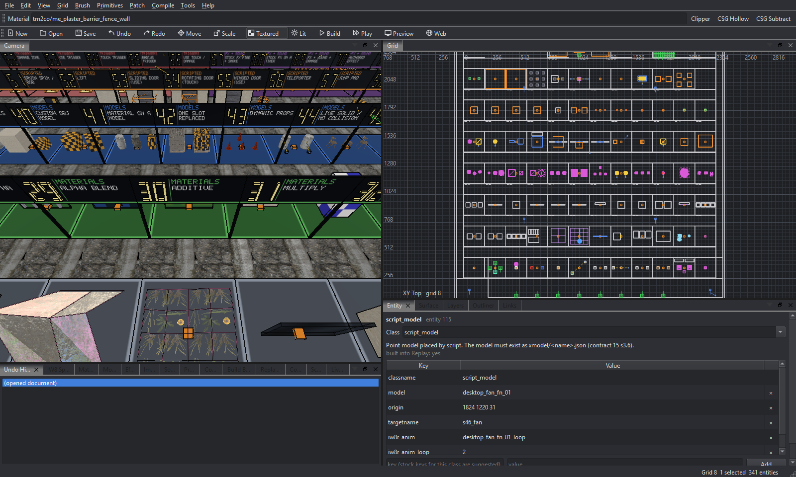

<table>
  <tr>
    <td width="33%"><br><b>Lit preview</b><br>Sun, lights and shadows in the editor</td>
    <td width="33%">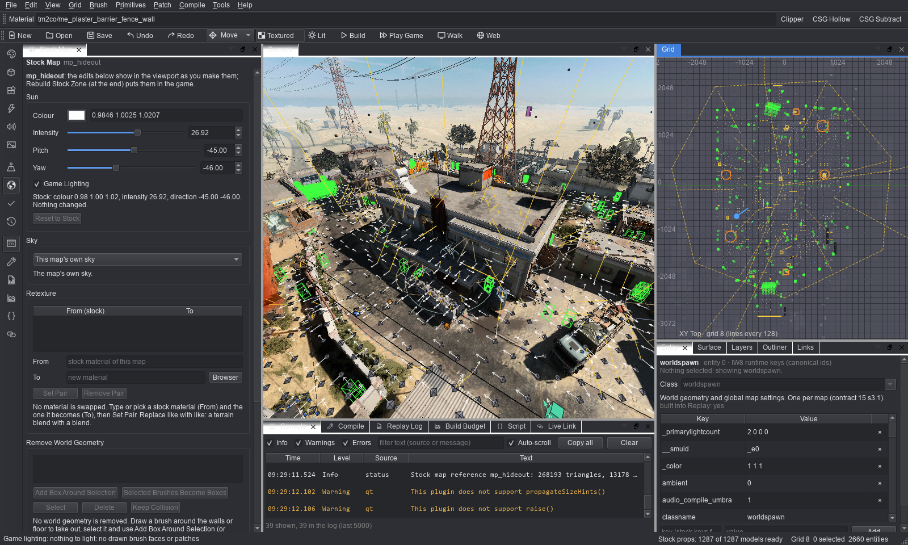<br><b>Stock maps</b><br>Open, edit and rebuild the game's own maps</td>
    <td width="33%">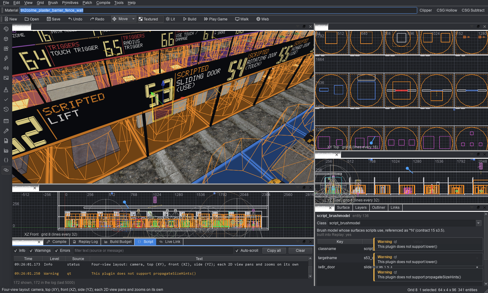<br><b>Radiant editing</b><br>Brushes, patches, terrain and four views</td>
  </tr>
  <tr>
    <td>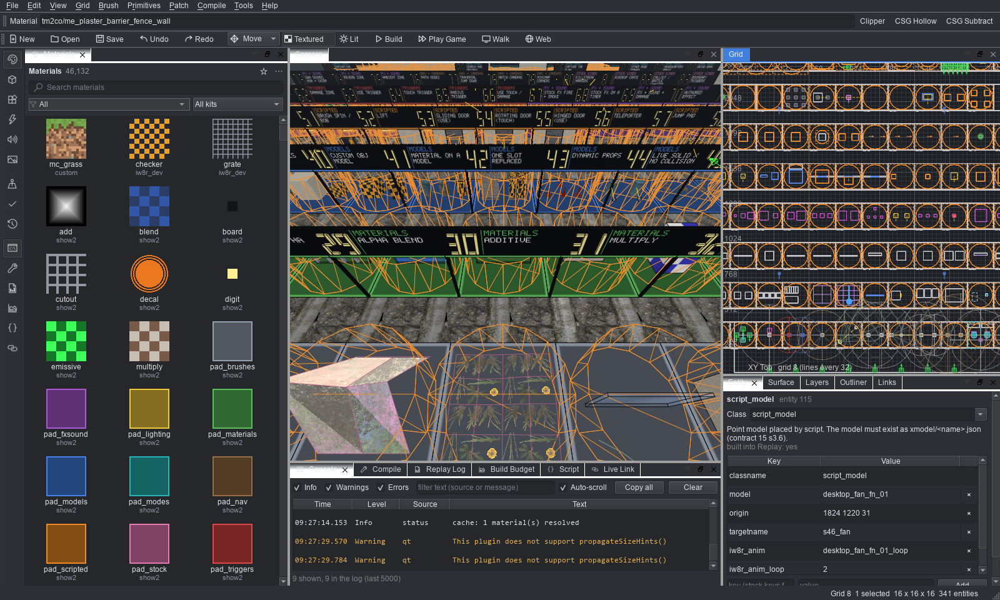<br><b>Asset browsers</b><br>Every stock material, model, image, effect and sound</td>
    <td>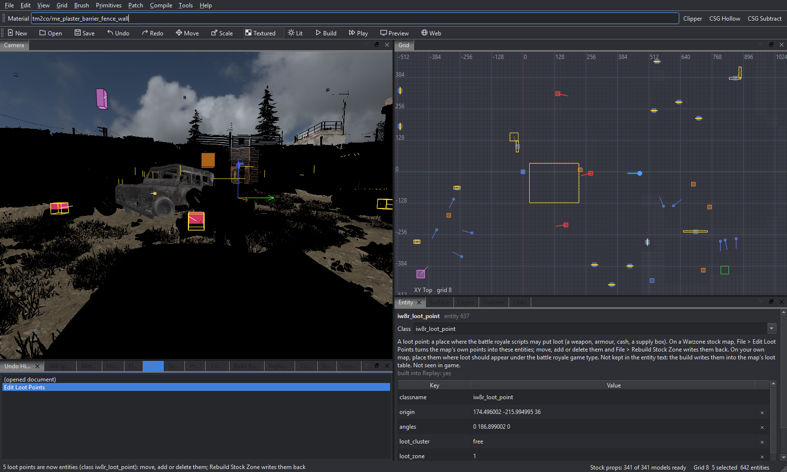<br><b>Warzone</b><br>Loot, buy stations and vehicles</td>
    <td>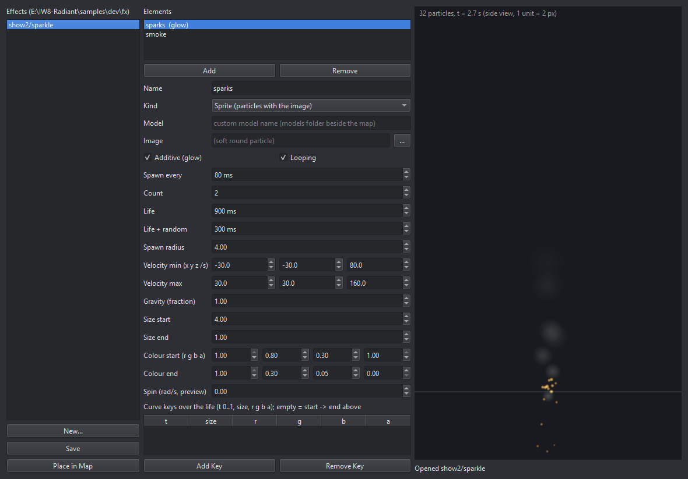<br><b>Custom content</b><br>Materials, models, effects, sounds and prefabs</td>
  </tr>
</table>

## Contents

- [Features](#features)
- [Requirements](#requirements)
- [Getting started](#getting-started)
- [Building from source](#building-from-source)
- [Documentation](#documentation)
- [License](#license)

## Features

### Level editing

- Brush editing with vertex, edge and face modes, the clipper, CSG hollow, subtract and merge, extrude, chamfer,
  inset and bridge.
- Tool materials for caulk, clip, player clip, weapon clip, ladders, water, triggers and sky.
- Primitives such as stairs, arches, cylinders, ramps and spheres, plus generators for stairs and simple buildings.
- Patches and terrain: sculpting brushes, height map import and export, erosion, roads and vertex painting.
- Move, rotate and scale gizmos, array and radial duplicate, mirror, align, distribute, layers, regions and selection
  sets.
- Undo history with up to 1,024 steps, copy and paste between maps, and configurable keyboard shortcuts with
  Radiant-style presets.

<table><tr>
  <td width="50%">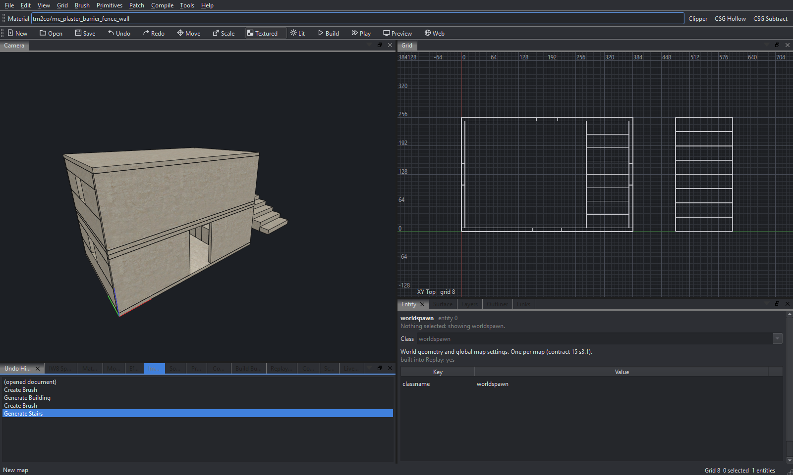<br>Generated building and stairs</td>
  <td width="50%"><br>UV editor</td>
</tr></table>

### Views and lighting

- A Direct3D 11 camera with textures, normal maps, gloss, glass, emissive materials and the sky.
- Camera modes: textured, flat, wireframe, fullbright, normals, contents, texel density and collision.
- Lit preview with the sun, every light and shadows.
- Game Lighting: the view shaded the way the game shades the map, including a stock map's lightmaps, reflection
  probes, lamps, fog, colour grading, bloom, screen-space reflections and ambient occlusion.
- Play mode: walk through the map with sprinting, jumping, mantling, sliding, ladders and noclip.
- Previews of fog, colour grading, wind, moving objects and effects, plus heat maps for lights and spawns.
- Camera bookmarks, camera paths with frame export, and high-resolution screenshots.

<table><tr>
  <td width="50%">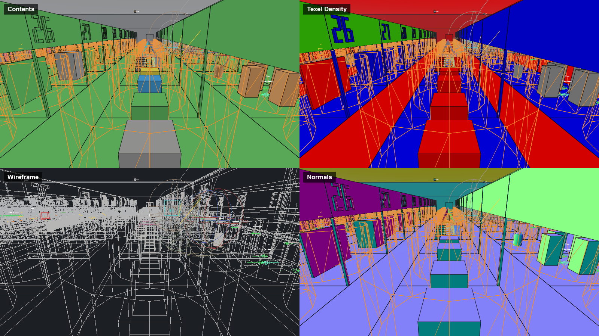<br>Camera modes</td>
  <td width="50%">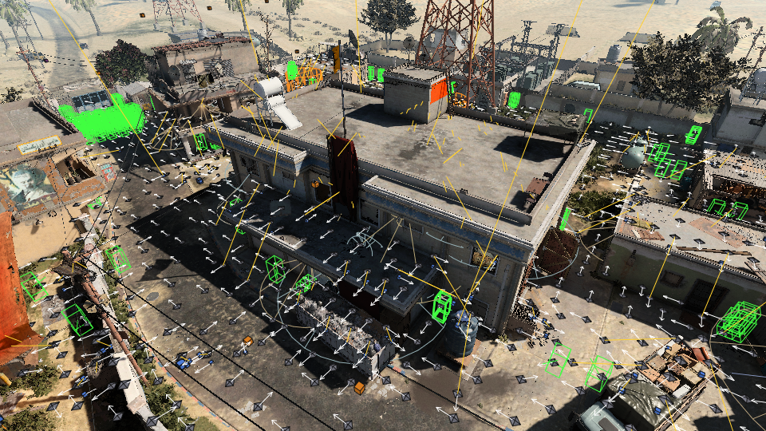<br>Game Lighting on a stock map</td>
</tr></table>

### Assets

- Browsers for every stock material, model, image, effect and sound in the game, with search, filters, thumbnails,
  3D model previews, live effect previews and sound playback.
- Information windows for materials, models and effects.
- Your own textures and materials, with a material editor and live preview.
- Your own models from OBJ, glTF and GLB files, with levels of detail and collision.
- Your own sprite effects, made in the effect editor, and your own sounds from WAV and MP3 files.

<table><tr>
  <td width="33%"><br>Models</td>
  <td width="33%">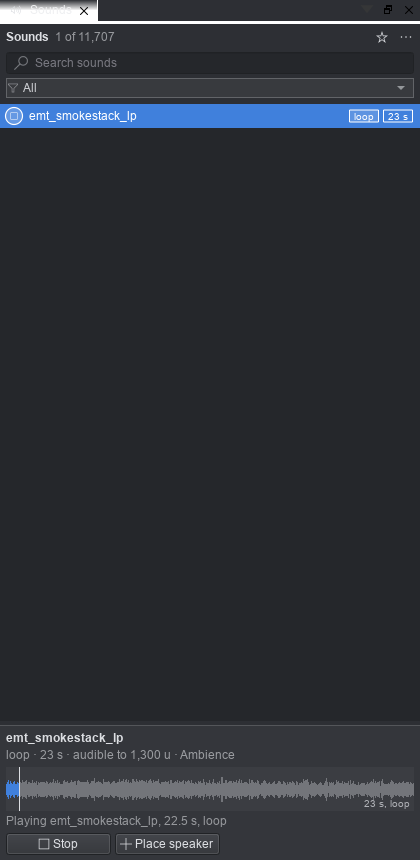<br>Sounds</td>
  <td width="33%">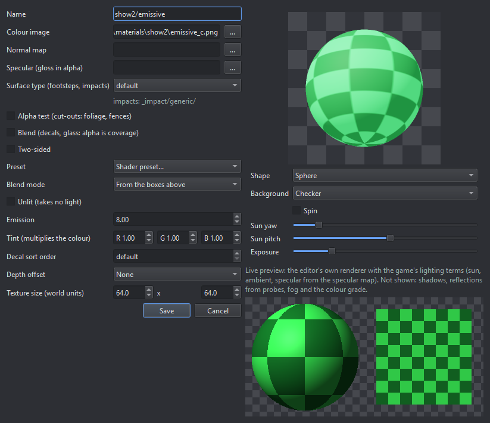<br>Material editor</td>
</tr></table>

### Prefabs

- Prefab bundles that carry geometry, entities, scripts and your own assets as a single object.
- Parameters per prefab, editable for each placement in the entity inspector.
- Edit a prefab in place and every placement updates. Share prefabs as zip files.

<table><tr>
  <td width="50%"><br>Prefab browser</td>
  <td width="50%"><br>Prefab parameters</td>
</tr></table>

### Gameplay

- Spawns for every game mode, spawn checks and automatic spawn generation.
- Objectives for Domination, Hardpoint, Search and Destroy and Capture the Flag.
- Triggers, teleporters, jump pads, doors, lifts, breakable glass and moving models, without scripting.
- The game's own interactive objects, such as doors, cones and vehicles.
- A script editor with syntax highlighting, completion and behaviour templates.
- An entity inspector with help for every key, a link view and map checks with automatic fixes.

<table><tr>
  <td width="50%">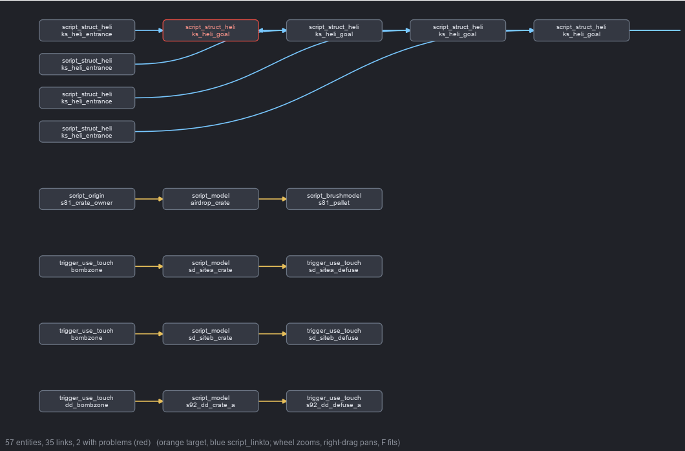<br>Entity links</td>
  <td width="50%"><br>Map checks</td>
</tr></table>

### Lighting and atmosphere

- Spot and omni lights with shadows and IES profiles.
- Sun and sky settings with any stock sky, time-of-day presets and custom skies from panoramas.
- Fog, colour grading and all vision settings.
- Lightmap baking and reflection probes.

<table><tr>
  <td width="33%">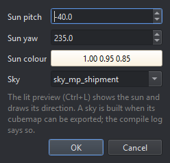<br>Sun and sky</td>
  <td width="33%">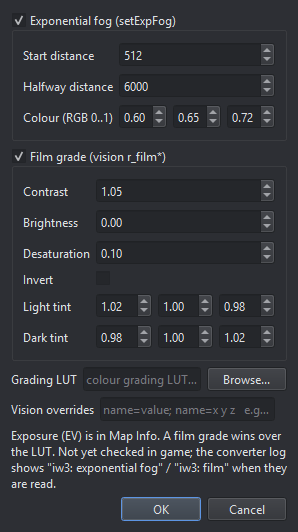<br>Atmosphere</td>
  <td width="33%">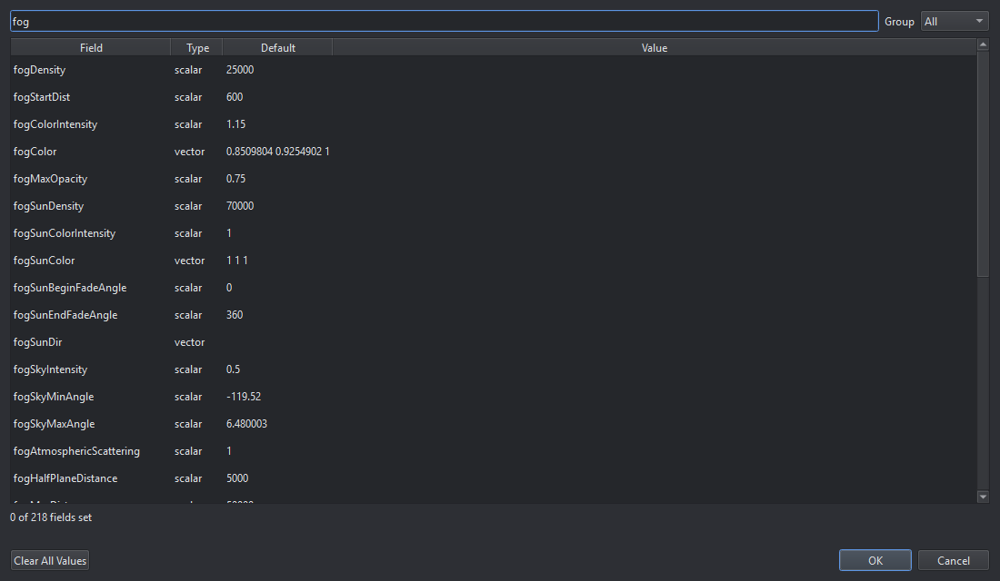<br>Vision editor</td>
</tr></table>

### Building and testing

- One key builds the map into the game's zone files and checks every zone with the game's own loaders.
- One key builds the map, installs it, starts the game and loads the map.
- Large maps use the game's streamed collision layout.
- A build budget against the game's limits, build reports and shareable map packages.
- Live Link: follow the game camera, move the player, send console commands and update objects while the game runs.

<table><tr>
  <td width="50%"><br>Build budget</td>
  <td width="50%">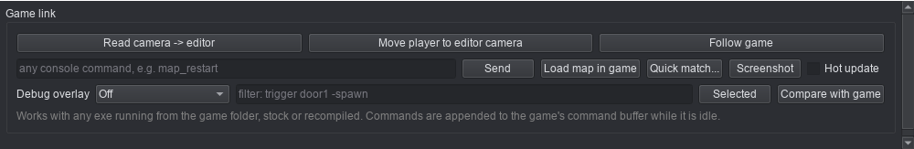<br>Live Link</td>
</tr></table>

### Stock maps and Warzone

- Open any stock multiplayer map with its world and props.
- Change entities and spawns, add models and brushes, hide props, and change the sun, sky, fog and textures.
- Rebuild the map in seconds, install it into the game and restore the original at any time.
- Warzone game mode presets, loot points, buy stations and vehicles, on stock maps and on your own maps.

<table><tr>
  <td width="50%"><br>Buy stations on a Warzone map</td>
  <td width="50%"><br>Game mode presets</td>
</tr></table>

### Workflow

- A command palette, help search, a first-map guide and a tutorial map.
- Command scripts, macro recording and a command-line tool.
- Autosave with history, backups, crash reports and a safe mode.
- A web interface for using the editor from a browser.

## Requirements

- Windows 10 or 11, 64-bit, with a Direct3D 11 graphics card.
- Call of Duty: Modern Warfare (2019), game build Replay 1.20.4.7623265 (`game_dx12_ship_replay.exe`, MD5
  `1c238fe327f2ecc3b0db924c5b425439`). IW8 Radiant reads the game you own; no game files are included.
- The Microsoft Visual C++ 2015-2022 redistributable (x64).

## Getting started

1. Install IW8 Radiant, or build it from source as described below.
2. Start `IW8Radiant.exe`. The first-run setup asks for the game folder and finds the game's files.
3. Open the tutorial map `samples/tutorial/iw8r_tutorial.map` and follow the [tutorial](docs/TUTORIAL.md).
4. Press F7 to build a map and F5 to play it in the game.

## Building from source

Prerequisites: Visual Studio 2022 with the C++ desktop workload, [xmake](https://xmake.io) 2.8 or later, and Qt 6.8.3
for MSVC 2022 (64-bit).

```bash
git clone --recursive https://github.com/IDARETW/IW8r.git
cd IW8r
xmake f -m release --qt=<path to Qt>\6.8.3\msvc2022_64 -y
xmake build -y IW8Radiant
```

The editor and its build tools are written to `bin\release`. To run the tests:

```bash
powershell -NoProfile -ExecutionPolicy Bypass -File tools\run_all_tests.ps1
```

To build an installer, install Inno Setup 6 and run `tools\build_installer.ps1`.

## Documentation

- [User guide](docs/USER_GUIDE.md)
- [Tutorial](docs/TUTORIAL.md)
- [Entity keys reference](docs/KEYS_REFERENCE.md)

## License

IW8 Radiant is released under the GNU General Public License v3.0; see [LICENSE](LICENSE). It includes code from
gsc-tool, x64-zt, atian-cod-tools and several libraries, listed with their licenses in
[THIRD_PARTY.md](THIRD_PARTY.md).

IW8 Radiant is a community project and is not affiliated with or endorsed by Activision or Infinity Ward. Call of Duty
and Modern Warfare are trademarks of Activision Publishing, Inc.
