# IW8 Radiant Suite

**A Radiant-style map editor for Call of Duty: Modern Warfare (2019).** Build your own multiplayer maps, or open the
game's own maps (Warzone included) and change them, then build them into the game's real zone files and play them,
all from one Windows application. It aims to give IW8 mappers the depth of tooling that
[iw3xo-radiant](https://github.com/xoxor4d/iw3xo-radiant) gives CoD4 mappers, built on IW8's own data rather than as an
IW3 or IW7 conversion front end.


**Target game build:** MW2019 *Replay* **1.20.4.7623265** (`game_dx12_ship_replay.exe`, MD5
`1c238fe327f2ecc3b0db924c5b425439`). You need your own copy of the game; nothing from it is part of this repository.
[docs/ARCHITECTURE.md](docs/ARCHITECTURE.md) explains why this build and which evidence ties formats and addresses to
it.

<table>
  <tr>
    <td width="33%">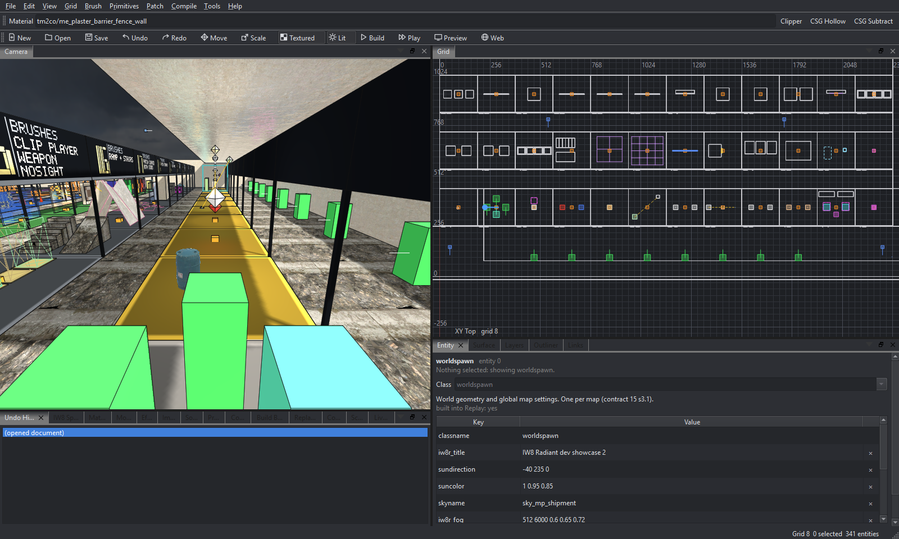<br><b>Lit preview</b>: the sun, lights and shadows as the game draws them</td>
    <td width="33%"><br><b>Stock maps</b>: open any stock map in Game Lighting, edit it beside the camera, rebuild it</td>
    <td width="33%"><br><b>Radiant editing</b>: brushes, patches, terrain, CSG and four views</td>
  </tr>
  <tr>
    <td><br><b>Every stock asset</b>: materials, models, images, effects and sounds, with previews</td>
    <td><br><b>Warzone</b>: loot, buy stations and vehicles on stock and custom maps</td>
    <td><br><b>Your own assets</b>: materials, models, effects, sounds and prefab bundles</td>
  </tr>
</table>

## Contents

- [Features](#features)
  - [1. Editing](#1-editing) · [2. Views, preview and Game Lighting](#2-views-preview-and-game-lighting) ·
    [3. Asset browsers](#3-asset-browsers) · [4. Materials and textures](#4-materials-and-textures) ·
    [5. Models](#5-models) · [6. Prefab bundles](#6-prefab-bundles) ·
    [7. Entities, spawns and game modes](#7-entities-spawns-and-game-modes) ·
    [8. Lights, sky, fog and vision](#8-lights-sky-fog-and-vision) · [9. Effects and sound](#9-effects-and-sound) ·
    [10. Behaviours and scripting](#10-behaviours-and-scripting) · [11. Building and playing](#11-building-and-playing) ·
    [12. Live link and in-game testing](#12-live-link-and-in-game-testing) ·
    [13. Stock map editing](#13-stock-map-editing) · [14. Warzone](#14-warzone) ·
    [15. Web access](#15-web-access) · [16. Tools, automation and safety](#16-tools-automation-and-safety) ·
    [Not done yet](#not-done-yet)
- [Build](#build) · [Run](#run) · [Test](#test) · [Layout](#layout) · [Documentation](#documentation) · [Licence](#licence)

## Features

How far each feature has been proven:

| Mark | Meaning |
|---|---|
| ✅ | Seen working in the game in a playtest |
| 🧪 | Built and checked offline (the game's own loaders, read-back, tests), not yet seen in the game |
| (none) | An editor feature: it works in the editor |

The complete list, with every menu path and key, is [docs/features/FEATURES.md](docs/features/FEATURES.md); how to use
each feature is in [docs/USER_GUIDE.md](docs/USER_GUIDE.md).

### 1. Editing

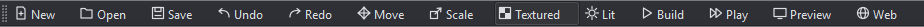

**Brushes**
- Drag a box in a 2D view; drag inside a selection to move it, outside to resize the nearest faces; vertex (V), edge (E)
  and face editing, each drag one undo step.
- Clipper (2- and 3-point), CSG Hollow, Subtract and Merge, Extrude, Chamfer, Inset, Bridge two faces, arbitrary
  rotation and scale with texture lock, Auto Caulk.
- Tool materials: caulk, nodraw, clip, player clip, weapon clip, AI-sight clip, ladder, water, trigger, hint, skip and
  sky, each behaving as in the game ✅. Detail, structural and non-colliding flags.
- Arrange: array and radial duplicate, mirror copy, align, distribute; splines (walls, posts, pipes) through points.
- Primitives: stairs, arch, cylinder, cone, sphere, ramp, prisms and shape models ✅; **Generate Stairs** and
  **Generate Building** fill the selection.


**Patches and terrain**
- Patches with row and column tools, caps, welds, thicken, lock border / corner vertices, a Patch Inspector.
- Terrain: create, noise, smooth, a terrain brush (raise, lower, smooth, flatten), height map import / export with
  thermal and hydraulic erosion, Blend By Slope for layered materials, roads draped through points.
- Vertex paint (colour and alpha) ✅, and Paint Mesh on brush faces 🧪.

**Selection and workflow**
- Grid 0.5 to 512, select by shape, select connected, hide / show, face selection, measure tool, regions,
  layers, workspaces, selection sets, copy and paste between maps, exact undo with a 1,024-step History panel.
- A move / rotate / scale gizmo with a preview of the result while you drag.
- Hotkey presets: IW8 Radiant, stock CoD Radiant and iw3xo-radiant; every key can be changed. F1 lists them all.

<table><tr>
  <td width="50%"><br>Four-view layout: camera, top, front and side</td>
  <td width="50%">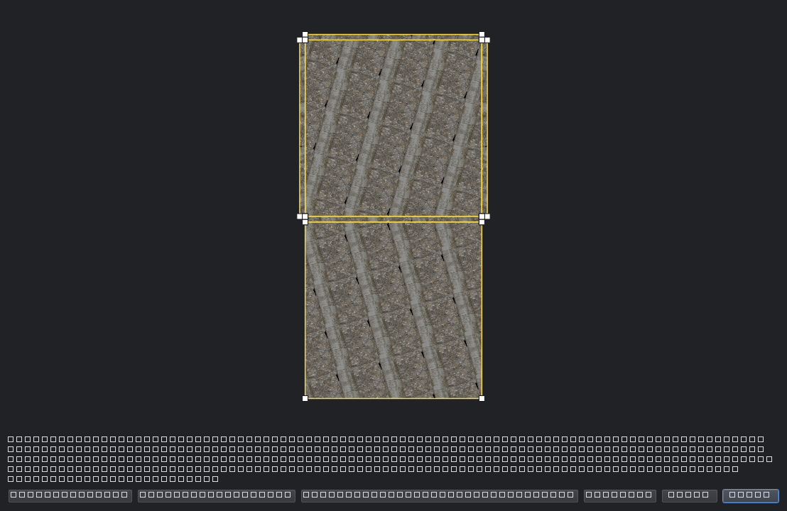<br>UV editor: brush faces unfolded as a net with their texture</td>
</tr><tr>
  <td>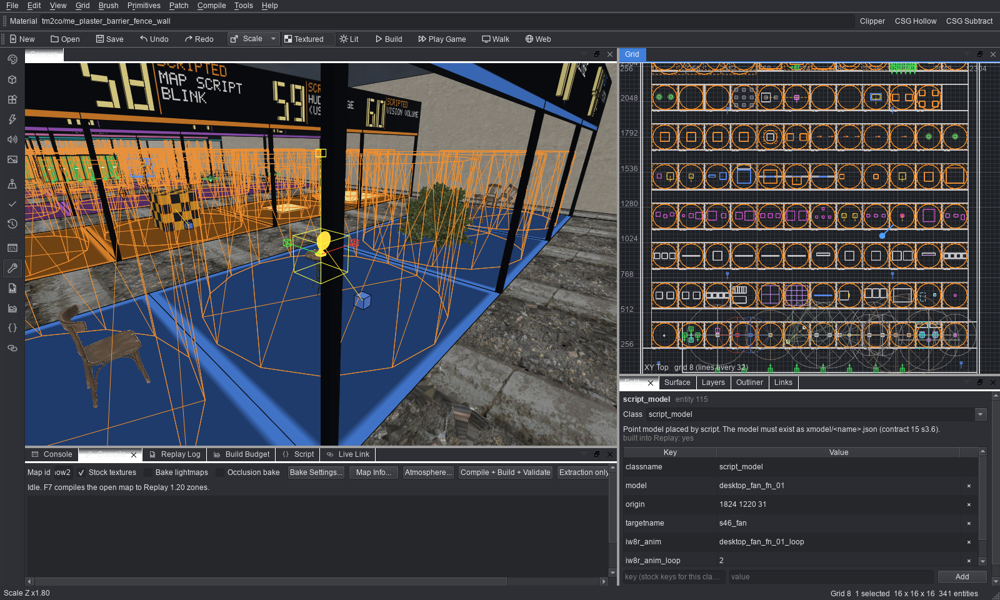<br>The gizmo's scale handle: the outline is the size after release</td>
  <td>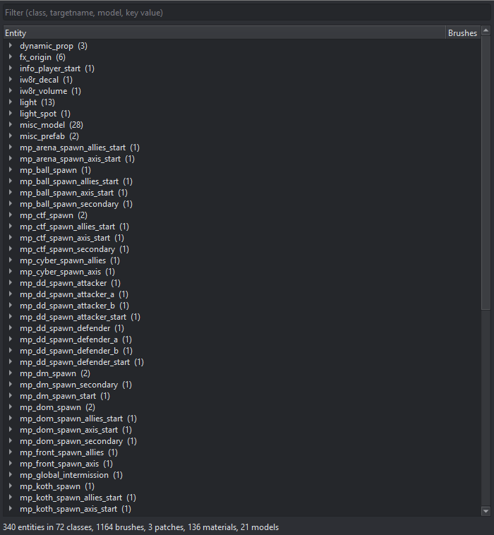<br>Outliner: entities by class with counts and map statistics</td>
</tr></table>

### 2. Views, preview and Game Lighting

- **Direct3D 11 camera** with textures, normal maps and gloss ✅, emissive glow, blended glass, the stock sky, the
  nearest reflection probe, and a right-click menu (move here, drop to floor, add a shape, enter a prefab).
- **Camera modes** ✅: Textured, Flat, Wireframe, Fullbright, Normals, Contents, Texel Density and Collision Only.
- **Lit preview** (Ctrl+L) ✅: the sun with shadows and every light per pixel, calibrated against the game.
- **Game Lighting** (Ctrl+Alt+L): the camera shaded the way the game shades the map. A stock map with its own
  lightmaps, light grid, reflection probes, lamps with shadows, exposure and colour grade, fog, bloom, white balance,
  screen-space reflections and ambient occlusion; your own map as the build will light it.
- Fog, colour grade, wind sway and behaviour previews (doors, lifts, spinning and bobbing models move in the camera);
  level-of-detail preview; heat maps for light overlap and spawn density.
- **Play preview** (P) ✅: walk the map with sprint, jump, mantle, crouch, slide, prone, ladders and noclip.
- Show what the last build made: its collision hulls, render triangles and navigation mesh.
- Camera bookmarks ✅, camera paths with frame export, 8K screenshots, top-down overview and turntable exports.

<table><tr>
  <td width="50%"><br>Lit preview: light entities and the sun with shadows</td>
  <td width="50%"><br>Contents, Texel Density, Wireframe and Normals</td>
</tr><tr>
  <td><br>Game Lighting on a stock map: its sun, lightmaps and grade</td>
  <td>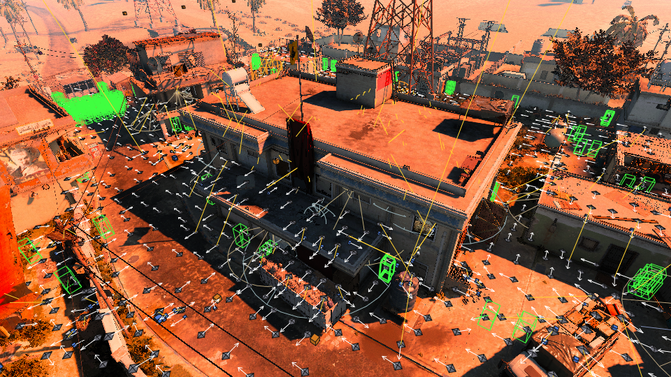<br>The same view after editing the sun: the viewport follows at once</td>
</tr></table>

### 3. Asset browsers

The side bar holds a browser for every kind of stock asset, each with one header line, a search box, one filter
drop-down (categories with counts, Recent, Loops, In this map), an edge-to-edge list and a details strip with the
actions for the selected item. Previews open instantly from a compressed menu cache that the editor builds once on
your machine (a start-up tip offers it).

- **Materials**: 29,650 thumbnails, type filter, kits (containers, foliage, urban, interiors), Apply / Faces /
  Replace / Info, drag onto a surface with a live preview.
- **Models**: 6,490 buildable models, category filter, a shaded 3D preview with triangle count, size and zone; place by
  double-click or drag.
- **Images**: 50,639 catalogue images as a thumbnail grid with DDS format facts.
- **Effects**: 1,020 effects in a folder tree with kinds, loop and length facts and a live particle preview that plays
  runners, models, lights and decals; Place fx_origin.
- **Sounds**: 11,707 aliases; play any row, lengths and variants, Loops filter, waveform.
- **Prefabs**, **Spawns** (by mode, add one here), **Undo History** (what each step touched) and the **Map Check**
  panel (findings by kind with Fix and Go to).

<table><tr>
  <td width="33%">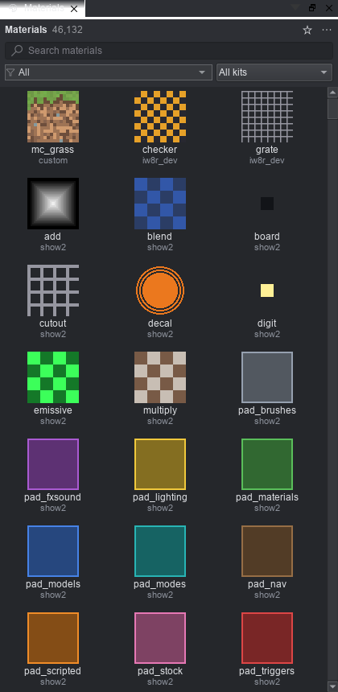<br>Materials</td>
  <td width="33%">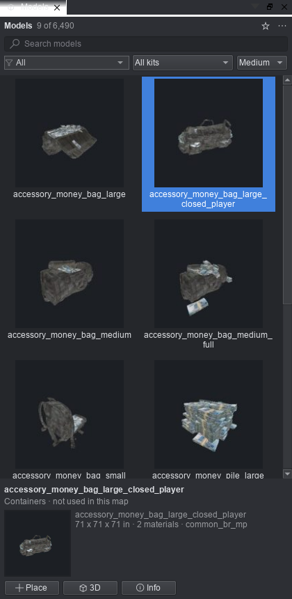<br>Models, with the selected model's preview</td>
  <td width="33%">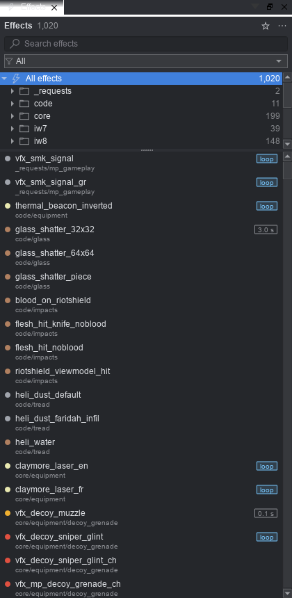<br>Effects in a folder tree with counts</td>
</tr><tr>
  <td><br>Sounds, playing the selected alias</td>
  <td>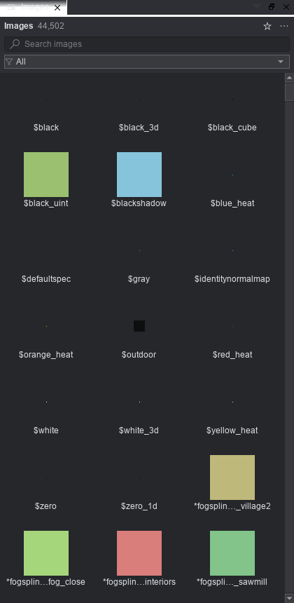<br>Images</td>
  <td>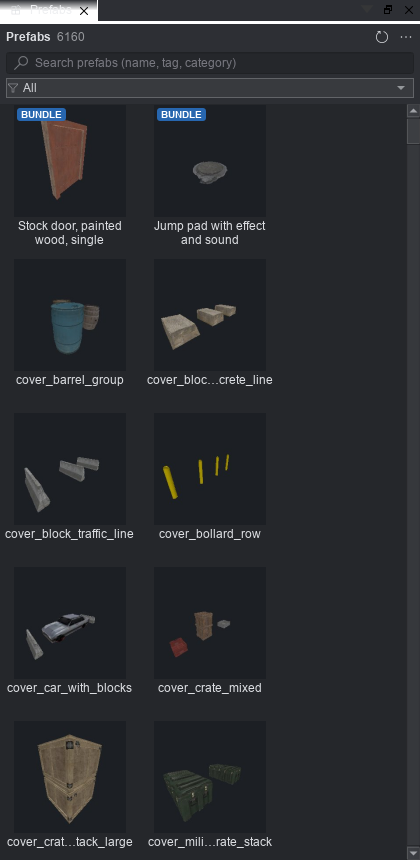<br>Prefabs</td>
</tr></table>

Info windows explain any asset: **Material Info** (kind, surface type, zone, technique set, images, texture table and
streaming state), **Model Info** (placements, bounds, every LOD with its draw distance, bones and tags) and
**Effect Info** (emitters, run time, materials, models, sounds, child effects, simulated bounds).

<table><tr>
  <td width="33%">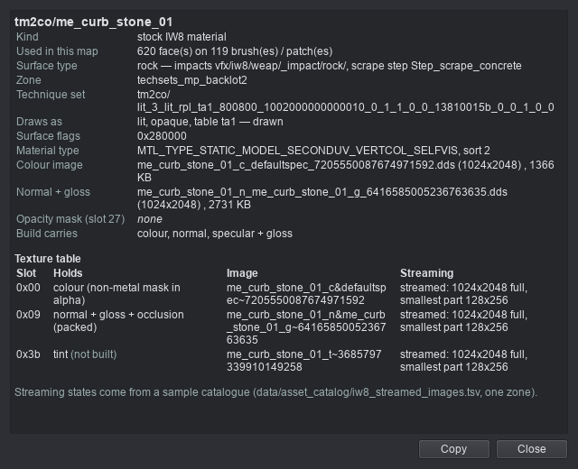<br>Material Info</td>
  <td width="33%">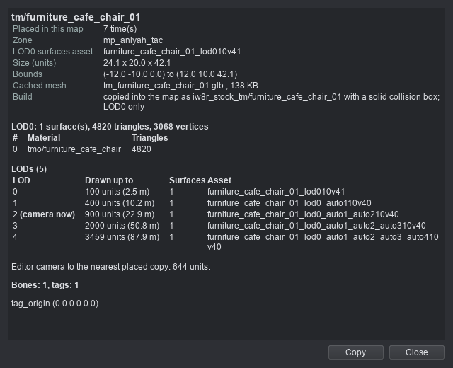<br>Model Info</td>
  <td width="33%">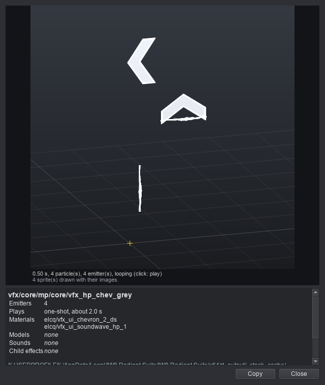<br>Effect Info</td>
</tr></table>

### 4. Materials and textures

- Any stock material by name; its images are read from the game on first use and cached ✅. Builds carry the colour,
  normal and gloss images ✅, cut-outs (chain-link, foliage) ✅ and the material's tint 🧪.
- **Custom textures and materials**: import PNG, TGA, JPG or BMP ✅; the Material Editor sets colour, normal and
  specular images, surface type, alpha test or blend, two-sided, size in world units, shader presets (opaque, cut-out,
  blended, additive glow, multiply, decal, unlit sign, emissive) 🧪, with a live preview on a sphere, plane or cube.
- Make an editable copy of a stock material, adjust images (levels, hue, channels, normal from height), replace a
  material everywhere or on one model slot, Techset Info, texel density checks and a UV editor.

<table><tr>
  <td width="50%"><br>Material Editor with the live preview</td>
  <td width="50%">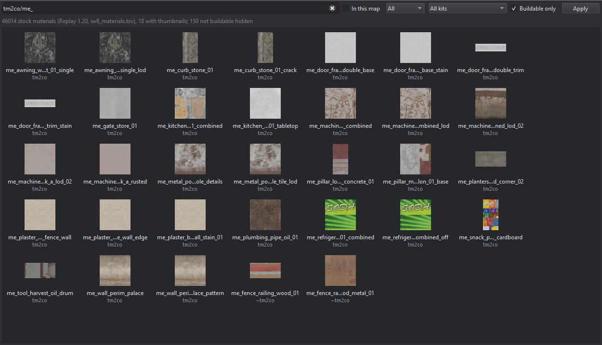<br>Material thumbnails, filtered</td>
</tr></table>

### 5. Models

- Place any of 6,490 stock models; the build carries them as textured copies with collision ✅.
- Import your own models from OBJ, glTF or GLB with LODs, a collision mesh and materials ✅.
- Convex-hull collision (up to four pieces) 🧪, `lod_scale` ✅, `no_shadow` ✅, `ground_lighting` ✅, a material
  override per model ✅, spin and bob without script ✅, physics props (`dynamic_prop`) ✅, destructible models and
  stock animations 🧪.
- Scatter models by radius, slope and material rules; model paint mode; drop to floor.

<table><tr>
  <td width="50%">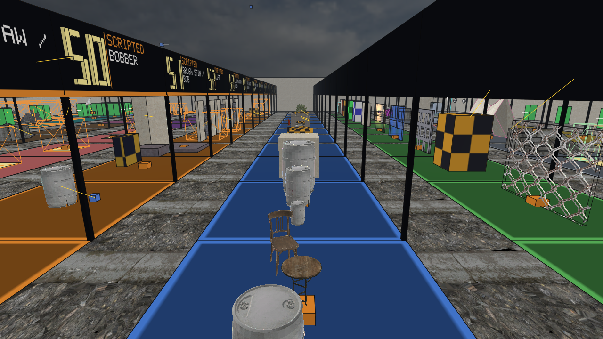<br>Stock models, a shape model and custom crates in the camera</td>
  <td width="50%">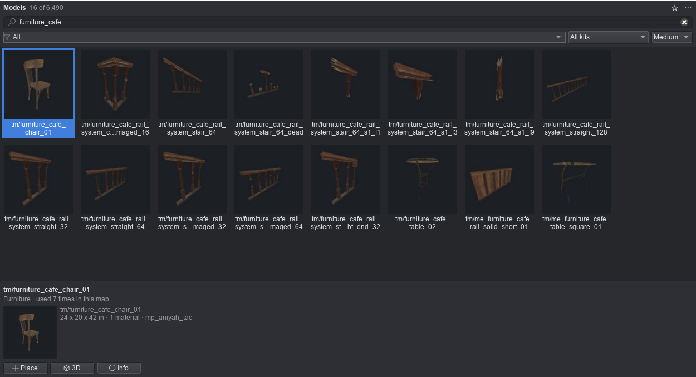<br>The Models browser with a shaded preview</td>
</tr></table>

### 6. Prefab bundles

- A prefab bundle is a folder that carries brushes and entities with all their keys, your own materials, models,
  sounds and effects, an optional script, a title, tags and **parameters** (each with a range and default).
- Place by drag or double-click; each placement keeps its own names; edit its parameters in the Entity dock; enter a
  prefab to edit it and every placement follows; explode, make unique, per-placement overrides.
- Save Selection As Prefab lists everything that travels with it; export and import bundles as zip files; fallback
  contents when a build feature is missing.
- Shipped bundles include a jump pad (effect, sound and launch speed parameter) and the stock wooden door of Talsik
  Backlot as the game's real scripted door.

<table><tr>
  <td width="33%">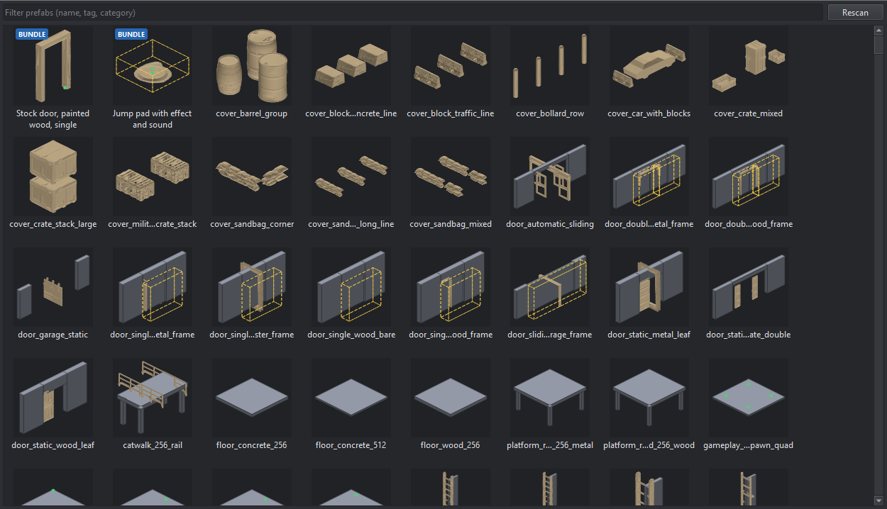<br>Bundles and the prefab library</td>
  <td width="33%">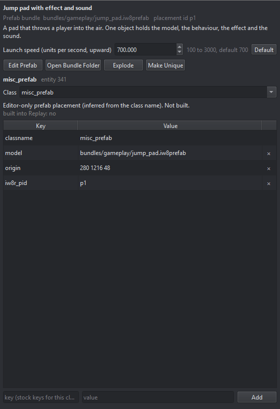<br>A placed bundle's parameters</td>
  <td width="33%">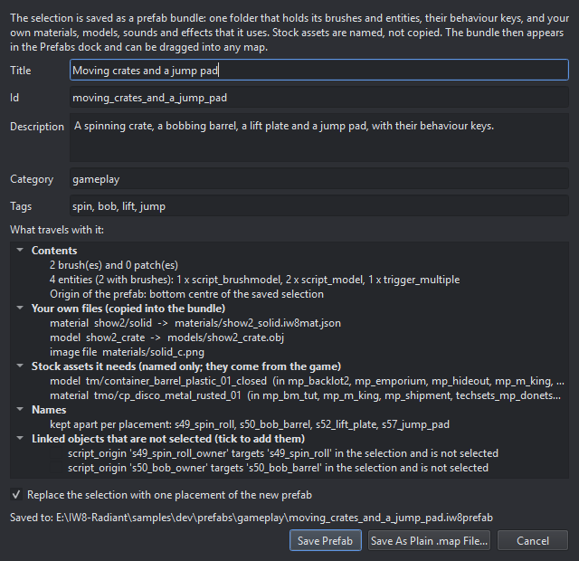<br>Save Selection As Prefab</td>
</tr></table>

### 7. Entities, spawns and game modes

- Entity inspector with help for every key from 98 class definitions, required keys, validation and suggestions;
  IW8 key names shown as names and stock spelling kept on save; unknown keys kept as written.
- Links view of target / targetname chains; Check Map and Map Doctor list problems and fix them on request
  (a spawn in a wall, a dangling target, a missing model).
- **Spawns** for every mode (all 39 stock spawn names) ✅, spawn checks (line of sight to enemy starts, spacing),
  **Generate Spawns** over the walkable floors, a spawn density heat map.
- **Triggers**: multiple, hurt, use, use-touch, radius, callout zones; jump pads and teleporters ✅.
- **Game mode objects**: Domination flags, Hardpoint zones, Search and Destroy sites and bomb, CTF flags, spawn sets
  and match cameras; the build lists the modes the map supports. Bot traversals 🧪.

<table><tr>
  <td width="33%"><br>Links: target chains as a node view</td>
  <td width="33%">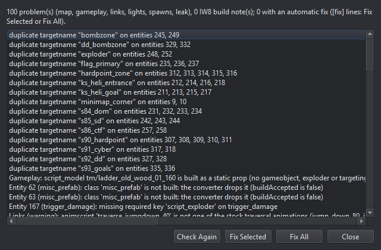<br>Check Map / Map Doctor</td>
  <td width="33%">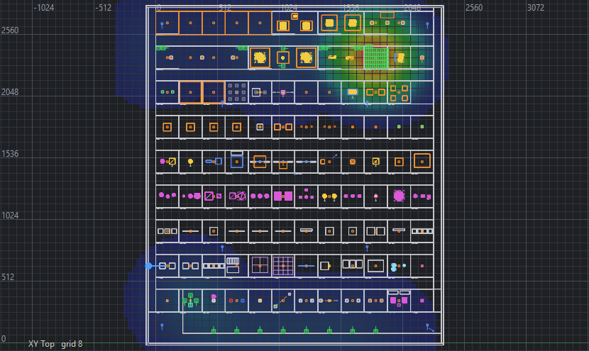<br>Spawn density heat map</td>
</tr></table>

### 8. Lights, sky, fog and vision

- Spot and omni lights with colour, intensity, radius, cone and shadows ✅; IES profiles with a polar-plot browser,
  bulb radius, falloff and more 🧪; a light budget and overlap heat map.
- **Sun & Sky**: sun pitch, yaw and colour, any stock sky, aim the sun at the sun painted in the sky ✅; time-of-day
  presets; custom skies from a panorama or HDR image 🧪; sun shadow range ✅.
- **Atmosphere**: exponential fog and film grade ✅, grading LUTs, the Vision Editor with all 218 vision fields 🧪,
  vision volumes, volumetric boxes and decal volumes 🧪.
- Lightmap baking (sky light, bounce in the surfaces' colours, sun shadows) with a preview in the camera 🧪; reflection
  probes captured before each build 🧪; a light grid for models and players ✅.

<table><tr>
  <td width="25%"><br>Sun &amp; Sky</td>
  <td width="25%"><br>Atmosphere</td>
  <td width="25%"><br>Vision Editor</td>
  <td width="25%">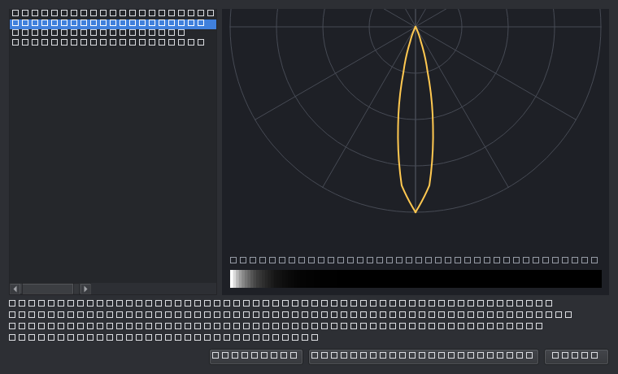<br>IES profiles</td>
</tr></table>

### 9. Effects and sound

- Place any stock effect with an `fx_origin` ✅ (drag from the browser ✅); preview every effect in the camera.
- **Effect Editor**: your own sprite effects with curves for size and colour, velocity, gravity, light and model
  elements, looping or one-shot 🧪; damage and sound on an effect 🧪.
- Place any stock sound alias with a `sound_emitter` ✅, ambient beds ✅, your own WAV / MP3 sounds, sound settings,
  reverb zones and interior occlusion 🧪.

<table><tr>
  <td width="50%"><br>Effect Editor with the animated preview</td>
  <td width="50%">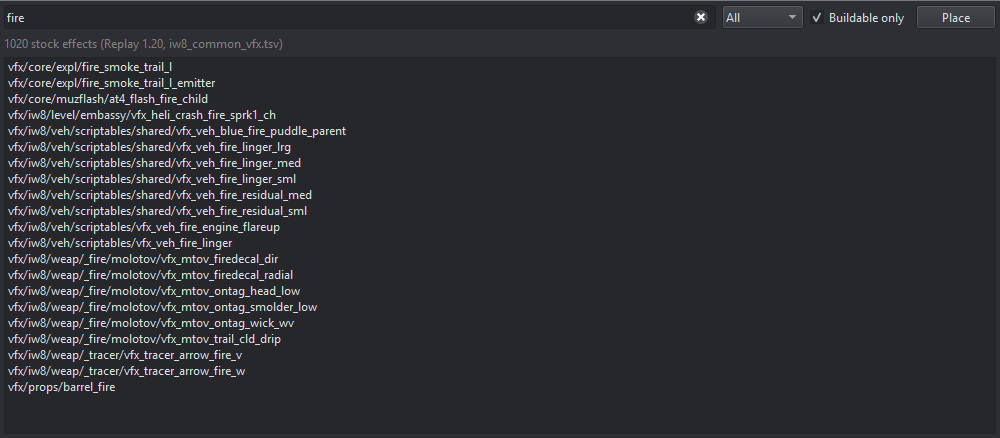<br>Stock effects, searched</td>
</tr></table>

### 10. Behaviours and scripting

- Behaviour keys, no script needed: spin and bob ✅, teleport ✅, jump pad ✅, damage, lifts, sliding and rotating
  doors, hinged doors, breakable glass ✅, ladders, animated models and vision triggers 🧪.
- The game's own **scriptable objects** (doors, cones, cars, fences) carried with their models and collision 🧪.
- **Script dock**: the map's own GSC with syntax colours, completion from 3,009 built-in names, checks with clickable
  lines, and Insert Behaviour templates. Compile errors open the script on the line.
- Your own HUD pictures and localized text for hints and HUD labels 🧪.

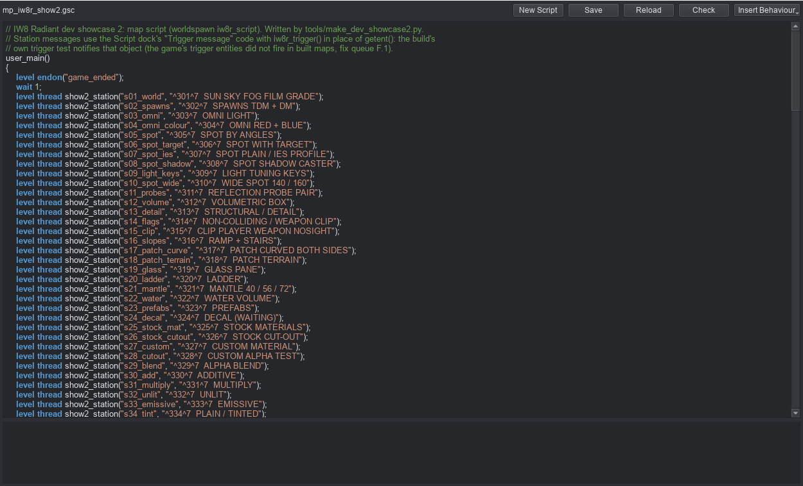

### 11. Building and playing

- **F7** builds the map: the editor's own compiler, then the zone writer, then every zone is loaded by the game's own
  loaders to check it. **Ctrl+F7** deploys it into the game's custom map folder with SHA-256 checks and a backup;
  **F5** builds, deploys, starts the game, hosts a private match and loads the map 🧪.
- Collision in one piece or as the game's own streamed tiles for big maps 🧪; an optional occlusion bake 🧪.
- A preflight check, incremental builds, a build report, zone dependencies, a **Build Budget** against the game's
  limits, Map Info (title, compass, minimap, game modes), a loadscreen from the camera, leak check.
- Map packages (zip) to share a map with its prefabs and assets; a release installer.

<table><tr>
  <td width="33%">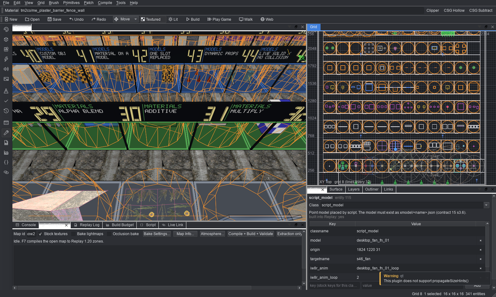<br>The Compile log under the camera</td>
  <td width="33%">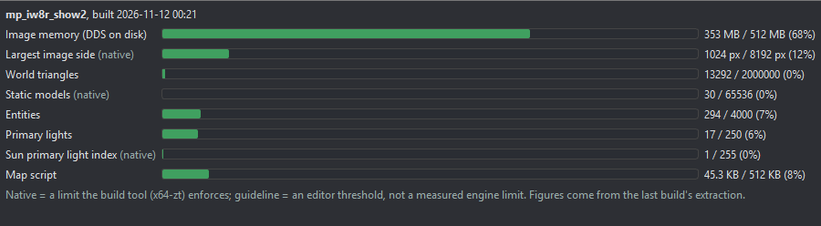<br>Build Budget</td>
  <td width="33%">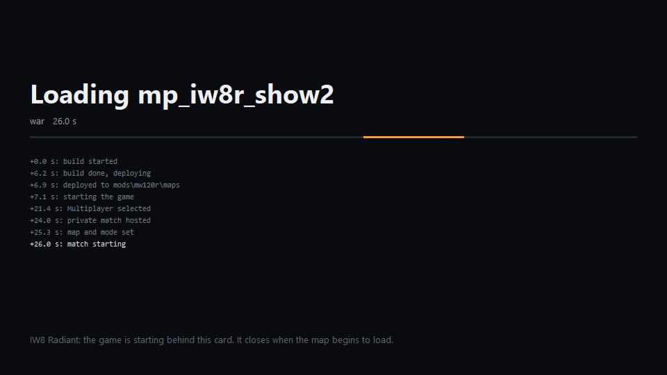<br>The F5 cover card while the game starts</td>
</tr></table>

### 12. Live link and in-game testing

- **Live Link** reads the player's camera, moves the player to the editor camera, follows the game live ✅, sends
  console commands, hot-updates moved models, effects, sounds and the sun ✅, loads the map, starts a quick match and
  grabs screenshots.
- A debug overlay in the game (entity labels, triggers, where am I, compare with the editor) 🧪.
- **Test Checklist**: each in-game check with OK / Wrong / Not tested and a note; the editor shows the result beside
  each feature.

<table><tr>
  <td width="50%"><br>Live Link</td>
  <td width="50%">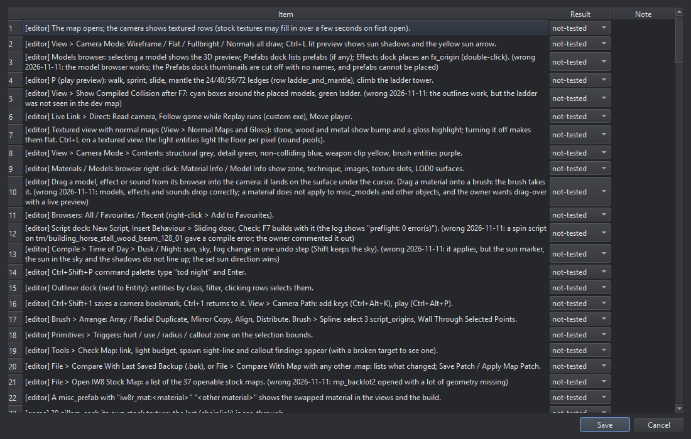<br>Test Checklist</td>
</tr></table>

### 13. Stock map editing

- **Open any of 37 stock multiplayer maps**: the entities become the document, the world and props are drawn as a
  textured reference (on Verdansk, the streamed world tiles around the camera load on request).
- Change entities, spawns, loot and placed objects; add models (from any stock map) and brushes; hide stock props;
  retexture the world; give a map another map's sky; relight its sun, fog and vision 🧪.
- **Rebuild Stock Zone** writes the changed zone in seconds, starting from the stock zone with its stock patch; the
  game's loaders check it; **Install** puts it into the game (the stock files are kept) and **Restore** undoes it.
- The Stock Map panel beside the camera edits the map's sun and more, and the viewport follows each edit at once.

<table><tr>
  <td width="33%"><br>mp_hideout in Game Lighting with the Stock Map panel beside the camera</td>
  <td width="33%">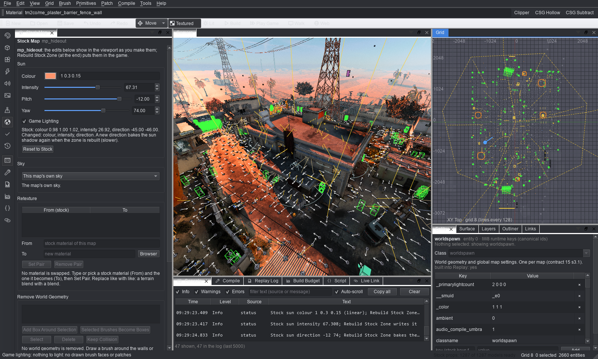<br>The sun edited in the panel: the viewport follows</td>
  <td width="33%">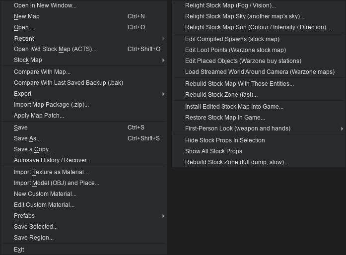<br>File &gt; Stock Map: open, edit, rebuild, install, restore</td>
</tr></table>

### 14. Warzone

- **Game mode presets**: the six core modes, Warzone Trios, Quads, Stimulus Solos and Blood Money, and small-map
  variants; edit and save your own, use one for F5 or carry it in the map; mode rules (health, speed, one weapon,
  infinite ammo) 🧪.
- **Loot**: loot points, supply boxes, loot clusters and zones on your own map and on stock maps (Verdansk has 23,446
  points), with the loot item definitions carried into your map 🧪.
- **Buy stations** and **vehicles** (ATV, Tac Rover, jeep, cargo truck, Little Bird) on your own map and on stock maps 🧪.
- Warzone on a small map, your own game type scripts, and the stock Warzone maps with the same edit and rebuild tools.

<table><tr>
  <td width="33%">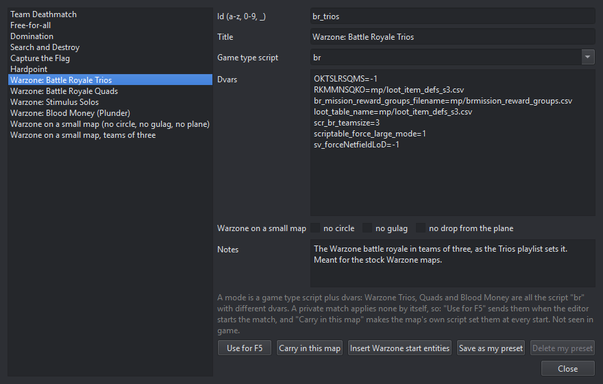<br>Game mode presets</td>
  <td width="33%"><br>Loot points on a stock map</td>
  <td width="33%">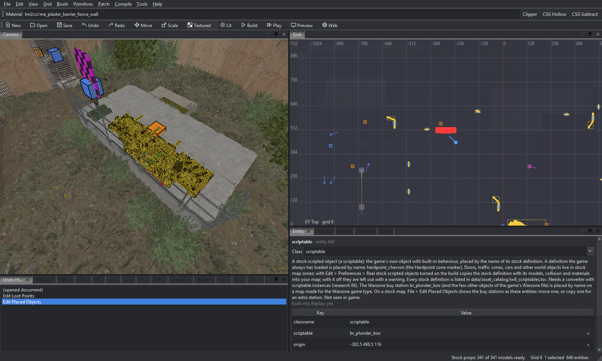<br>A buy station selected</td>
</tr></table>

### 15. Web access

- **Tools > Web Server** runs the suite in a browser, local by default (LAN optional, with a login and lockout).
- The editor's own live camera picture streamed to the browser (fly, select), 2D views, an entity list and inspector,
  drawing brushes, vertex and edge tools, placing entities, the editor's full menu bar and command search, and the main
  dialogs as forms (Sun & Sky, Atmosphere, Map Info, Game Modes, Check Map, Preferences, Surface, Vision).
- Compile, deploy, build and play from the browser; live updates of the document as it changes.

### 16. Tools, automation and safety

- Asset availability audit, asset usage, unused assets, a cache manager with size caps.
- Command scripts and macro recording, a **Command Palette** (Ctrl+Shift+P), the `iw8r` command line (info, diff,
  edit, report, preflight, generate-spawns, ...) and headless builds.
- Search Help (Shift+F1), a First Map Guide, a tutorial map, themes and a customizable toolbar, a Console with
  filters, toasts.
- Autosave with history, atomic saves with backups, compare with the last backup, crash reports, safe mode.
- **Everything it runs is built from this repository**: the GSC compiler (`iw8r-gsc.exe`, from gsc-tool), the zone
  writer and map converter (`iw8r-zt.exe`, from x64-zt) and the Replay zone reader (`iw8r-acts.exe`, from ACTS), each
  proven to give the same output as the program it came from ([docs/PLAN_OWN_TOOLS.md](docs/PLAN_OWN_TOOLS.md)).

<table><tr>
  <td width="33%">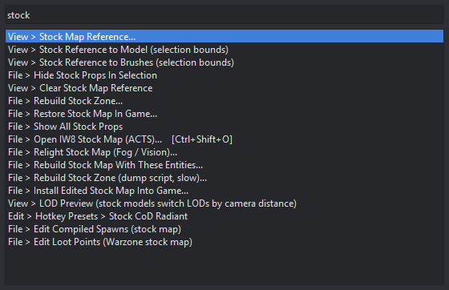<br>Command Palette</td>
  <td width="33%">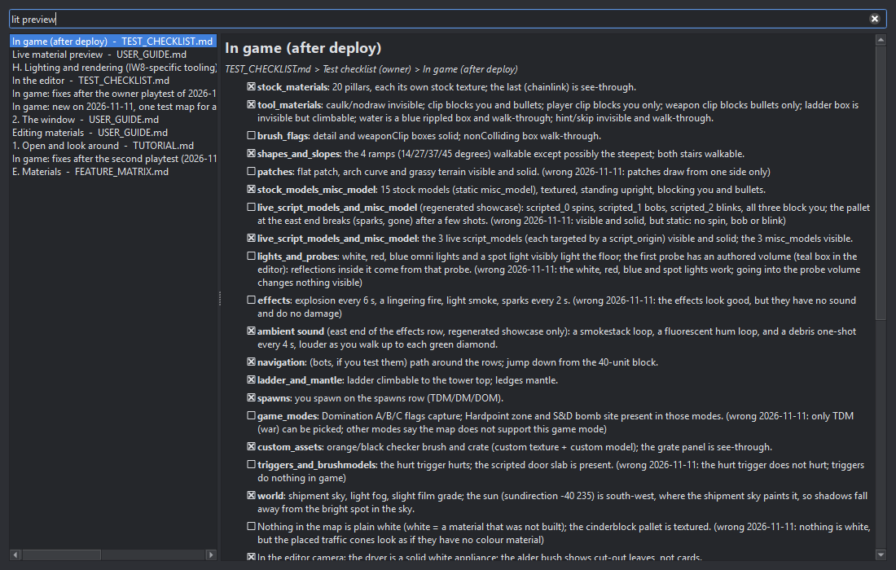<br>Search Help</td>
  <td width="33%">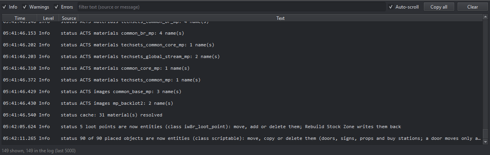<br>Console</td>
</tr><tr>
  <td>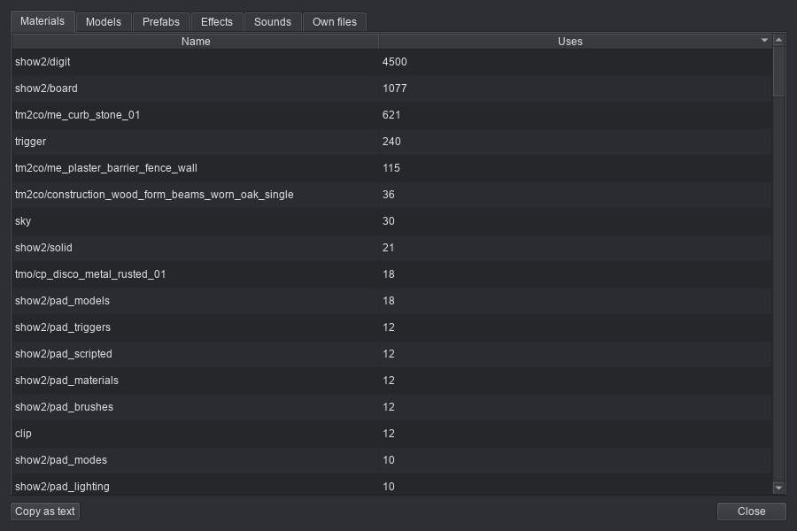<br>Asset Usage</td>
  <td>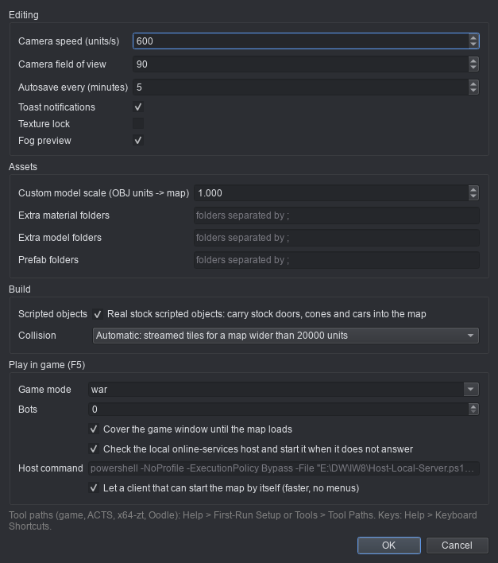<br>Preferences</td>
  <td>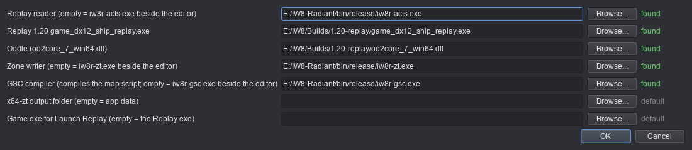<br>Tool Paths: only the game is needed</td>
</tr></table>

### Not done yet

Open items are tracked in [docs/ROADMAP.md](docs/ROADMAP.md) and [docs/TEST_CHECKLIST.md](docs/TEST_CHECKLIST.md).
The larger ones: a real visibility (Umbra) bake for custom maps beyond the optional occlusion bake, blending
vertex-colour layered materials on brushes, decal and runner elements in the Effect Editor, custom physics assets,
infil sequences, PA speakers and music states, navigation blockers, and in-game confirmation of the features marked 🧪.

## Build

Prerequisites:

- Windows 10/11 x64, Visual Studio 2022 Build Tools with *Desktop development with C++* (MSVC 14.44 tested)
- [xmake](https://xmake.io) 2.8+ (3.0.9 tested)
- Qt **6.8.3** `msvc2022_64` (any folder; `E:\Qt` below). To install it with aqtinstall:
  ```bash
  py -3.11 -m pip install --user aqtinstall
  ```
  ```bash
  py -3.11 -m aqt install-qt windows desktop 6.8.3 win64_msvc2022_64 -O E:\Qt
  ```

Clone with the submodules (Qt Advanced Docking System, bcdec):

```bash
git clone --recursive https://github.com/IDARETW/IW8r.git
```

From the repository folder:

```bash
xmake f -m release --qt=E:\Qt\6.8.3\msvc2022_64 -y
```
```bash
xmake build -y iw8r_tests
```
```bash
xmake build -y iw8r
```
```bash
xmake build -y IW8Radiant
```

Outputs land in `bin\release\`. The editor build runs `windeployqt`, so `IW8Radiant.exe` starts without Qt on `PATH`.
It also builds the three tools the editor runs, beside it: `iw8r-gsc.exe` (the GSC compiler), `iw8r-zt.exe` (the zone
writer and map converter) and `iw8r-acts.exe` (the Replay zone reader); see [THIRD_PARTY.md](THIRD_PARTY.md). The
editor needs nothing else but the game: the first-run setup (or *Tools → Tool Paths*) asks for the Replay folder.

Generate the IW8 canonical key table once (56,738 ids; the editor works without it, showing numeric ids except the
built-in essentials `classname`, `origin`, `angles`, `model`, `target`, `targetname`, `script_noteworthy`):

```bash
py -3.11 -I tools\gen_iw8_keytable.py src\tools\gsc\src\gsc\engine\iw8_token.cpp -o data\generated\iw8_canonical_keys.tsv
```

To make an installer: `tools\build_installer.ps1 -Zip` (Inno Setup 6) packages the editor, the three tools, the Qt
runtime, the data and every licence.

## Run

```bash
bin\release\IW8Radiant.exe samples\iw8\iw8_sample_room.map
```

Open a stock map (its world, props and entities, read from the game): *File → Open IW8 Stock Map*. The tutorial map
`samples/tutorial/iw8r_tutorial.map` and [docs/TUTORIAL.md](docs/TUTORIAL.md) walk through a first map.

Controls (defaults; *Edit → Hotkey Presets* and *Edit → Keyboard Shortcuts* change them, F1 lists them): RMB-drag look
(+W/A/S/D/Q/E fly), LMB click select in 3D, Shift+LMB select in 2D, LMB-drag inside the selection to move on the grid,
RMB/MMB pan and wheel zoom in 2D, `~` `1`–`9` grid sizes, `[` `]` grid step, Alt+arrows nudge, Space clone,
Backspace delete, Esc deselect, I invert, N entity inspector, End frame selection, Ctrl+Tab next 2D view, P play.

Build a map: open it, press **F7**, and watch the Compile log. Zones go to the output folder (default
`%LOCALAPPDATA%\IW8 Radiant Suite\...\x64zt_output\<map id>`). **F5** builds, deploys and starts the map in the game.

The command line tool `iw8r` does the extraction and map edits without the window:

```bash
bin\release\iw8r.exe edit samples\iw8\iw8_sample_room.map -o out\room_edit.map --grid 16 --select-brush 5 --move 30 -9 0 --select-entity mp_tdm_spawn_allies_start --set angles "0 90 0"
```
```bash
bin\release\iw8r.exe diff samples\iw8\iw8_sample_room.map out\room_edit.map
```

## Test

One command builds everything and runs the core tests, the end-to-end GUI test on Qt's offscreen platform and the
Direct3D 11 smoke test, with one summary line per suite:

```bash
powershell -NoProfile -ExecutionPolicy Bypass -File tools\run_all_tests.ps1
```

The GUI test never shows a window or moves the mouse, so it can run while you use the editor. Nothing in the test
suite starts the game or writes into the Replay install. The tools built from `src/tools` are checked against the
programs they came from with `tools/acts_parity.py`, `tools/zt_parity.py`, `tools/zt_editzone_parity.py` and the
compiler fixtures in `tests/data/gsc` ([docs/PLAN_OWN_TOOLS.md](docs/PLAN_OWN_TOOLS.md)). The feature screenshots
are made by `IW8Radiant.exe --feature-shots --out <folder>`.

## Layout

```
src/core/       lossless map / entity-string model, geometry, document and undo, the map compiler, IW8 formats
src/viewport/   Direct3D 11 renderer, render and pick cache, camera math (UI-toolkit independent)
src/qtapp/      the Qt 6 editor (Qt Advanced Docking System), GUI test, feature screenshots
src/cli/        the iw8r command line tool
src/tools/      the tools the editor runs: gsc (iw8r-gsc), zonetool (iw8r-zt), acts (iw8r-acts)
tests/          core tests and their fixtures
tools/          catalogue and data builders, offline proofs, parity checks, the test runner, packaging, tools/sync
samples/        the IW8 sample room, the dev showcase and the tutorial map
data/           entity definitions, asset catalogues, prefab bundles, shaders, the web client, the Replay schema
docs/           user guide, feature list, research notes, roadmap, test checklist, progress notes
third_party/    libraries (THIRD_PARTY.md); Qt Advanced Docking System and bcdec are submodules
```

## Documentation

| Document | What it holds |
|---|---|
| [docs/features/FEATURES.md](docs/features/FEATURES.md) | The complete feature list, with every menu path, key and status |
| [docs/USER_GUIDE.md](docs/USER_GUIDE.md) | How to use each feature |
| [docs/TUTORIAL.md](docs/TUTORIAL.md) | A first map, step by step |
| [docs/KEYS_REFERENCE.md](docs/KEYS_REFERENCE.md) | Every `iw8r_` key by entity class, with examples |
| [docs/TEST_CHECKLIST.md](docs/TEST_CHECKLIST.md) | The in-game checks that only the game can answer |
| [docs/ROADMAP.md](docs/ROADMAP.md) | Every item with its status (done, partial, open) and where its proof is |
| [docs/ARCHITECTURE.md](docs/ARCHITECTURE.md) | Target build and evidence, components, IW8 format facts |
| [docs/research/](docs/research/) | Evidence reports: game formats, Warzone, stock map editing, collision tiles, lighting, ... |
| [docs/PROGRESS.md](docs/PROGRESS.md) | Working notes for whoever continues the work |

## Licence

GNU General Public License v3 ([LICENSE](LICENSE)). The tools and libraries this repository contains, with their own
licences (gsc-tool and x64-zt: GPL-3; ACTS: MIT; the libraries: MIT, BSD, zlib, public domain; Qt and the Qt
Advanced Docking System: LGPL, dynamically linked), are listed in [THIRD_PARTY.md](THIRD_PARTY.md). No game files
are part of the repository or the installer: the editor reads the game you own.

This is a fan project for map making. It is not affiliated with or endorsed by Activision or Infinity Ward; Call of
Duty and Modern Warfare are their trademarks.
