# IW8 Radiant Suite: feature list

IW8 Radiant Suite is a Radiant-style map editor for Call of Duty: Modern Warfare (2019), game build Replay 1.20.4.7623265.
It edits `iwmap 4` `.map` files, previews them with textures, lights and a walkable player, and builds them into a
Replay map package. The build uses x64-zt (zonetool) and ACTS (a game-data export tool). The package is then deployed
into the game folder. Stock Replay maps can also be opened, changed and rebuilt.

Date: 2026-11-12

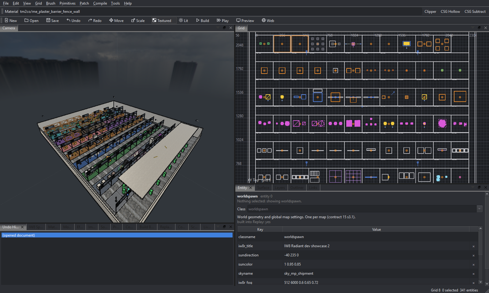

## How to read this list

- Each line says what a feature does. Menu locations are given as `Menu > Item` where the sources name them.
- Status tags:
  - (owner confirmed in game): the owner's test notes say it worked in the game.
  - (owner confirmed): the owner's notes say it worked in the editor, or the owner confirmed it in general.
  - (owner check pending): an editor item that the owner has not checked yet.
  - (not yet seen in game): built and checked offline, or changed after the last game test. It has not been seen working in the game.
  - No tag: the sources say nothing about how it works in the game.
- The owner's confirmations come from the playtests of 2026-11-10 and 2026-11-11. They are kept in `docs/TEST_CHECKLIST.md` and `docs/ROADMAP.md`.
- Press F1 in the editor for the full, searchable key list.

## Contents

1. [Editing basics](#1-editing-basics)
2. [Views and preview](#2-views-and-preview)
3. [Materials and textures](#3-materials-and-textures)
4. [Models and prefabs](#4-models-and-prefabs)
5. [Entities, spawns and game modes](#5-entities-spawns-and-game-modes)
6. [Lights, sky, fog and colour grading](#6-lights-sky-fog-and-colour-grading)
7. [Effects and sound](#7-effects-and-sound)
8. [Scripting and behaviours](#8-scripting-and-behaviours)
9. [Building and deploying the map](#9-building-and-deploying-the-map)
10. [Live link and in-game testing](#10-live-link-and-in-game-testing)
11. [Stock map editing](#11-stock-map-editing)
12. [Warzone and game modes](#12-warzone-and-game-modes)
13. [Asset tools](#13-asset-tools)
14. [Packaging, sharing and web access](#14-packaging-sharing-and-web-access)
15. [Automation and command line](#15-automation-and-command-line)
16. [Help, settings and safety](#16-help-settings-and-safety)
17. [Tests that guard the tool](#17-tests-that-guard-the-tool)
18. [Not built yet](#18-not-built-yet)

## 1. Editing basics

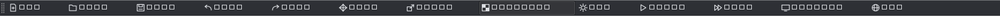

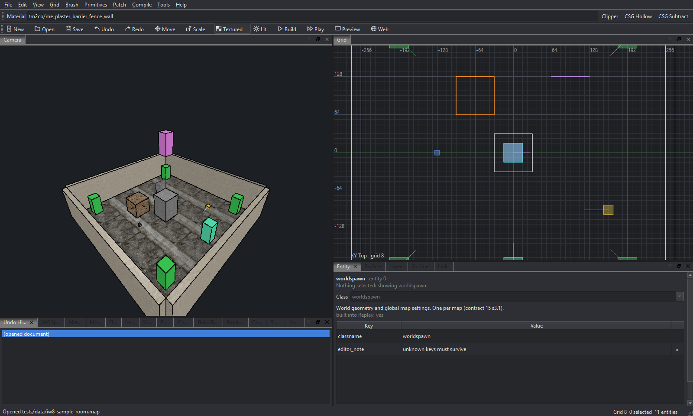

### Brushes

- Create a box brush: drag in a grid view. The brush takes the material in the toolbar's Material field.
- Move a brush: drag inside a selection. Drag outside a selection to resize the nearest faces.
- Vertex and face drag work (FEATURE_MATRIX, brush section). The vertex mode is V.
- Edge drag: press E in a grid view, then drag an edge midpoint. It is one undo step.
- Clipper (toolbar): 2-point and 3-point clips. Enter keeps one side. The key for keeping both halves is given differently in the user guide (Ctrl+Enter) and the roadmap (Shift+Enter). Flip is in the same tool.
- CSG Hollow (toolbar), Subtract (Shift+U) and CSG Merge.
- Extrude Selected Face: `Brush > Extrude Selected Face`, by a grid distance.
- Chamfer All Edges and Inset Selected Face: `Brush` menu. A bridge between two faces is not built.
- Rotate 90 and flip. Arbitrary Rotation and Scale are in the `Brush` menu, with texture lock applied.
- Auto Caulk: `Brush > Auto Caulk` sets the faces that touch other brushes to caulk.
- Brush flags: Ctrl+M makes a brush detail (it does not seal the map). `Brush > Make Structural` and `Brush > Toggle Non-Colliding` are also there.
- Tool Flags: `Brush > Tool Flags` sets or clears named flags. Unknown names are kept as written.
- Tool materials: `Brush > Tool Material` applies caulk, nodraw, clip, player clip, weapon clip, AI-sight clip, ladder, water, trigger, hint, skip and sky. (owner confirmed in game: caulk and nodraw are invisible, clip blocks the player and bullets, player clip blocks only the player, weapon clip blocks only bullets, the ladder brush is invisible but climbable, water is walk-through, hint and skip are invisible and walk-through.)
- Convert: `Brush > Convert Brush Faces to Patches`, and `Brush > Convert Selection to Static Model` (the selected brushes become one OBJ model with their materials).
- Arrange: `Brush > Arrange` has Array Duplicate, Radial Duplicate (owner confirmed), Mirror Copy across +X, +Y or +Z, Align Min, Center and Max per axis, and Distribute with equal gaps.
- Spline: `Brush > Spline > Wall`, `Posts` and `Pipe`, through the selected point entities. (owner confirmed in the editor: Wall Through Selected Points.)
- Primitives menu: stairs, arch, cylinder, cone, sphere, ramp, n-sided prism and shape models (for example Shape Models > Torus). Ramps and stairs were confirmed in game.
- Generate Stairs and Generate Building: `Primitives`. They fill the selection bounds with stairs or a one or two storey box building.
- Rope: `Tools > Create Rope`, between two selected points.

### Patches

- Shift+P creates a patch. The Patch menu inserts and deletes rows and columns, caps, welds, inverts, transposes, thickens, makes natural shapes, and splits and redisperses.
- Lock vertices: `Patch > Lock Border Vertices`, `Lock Corner Vertices`, and `Unlock Vertices`. Locked vertices draw red in vertex mode.
- Patch Inspector: `Patch > Patch Inspector` lists every control point as x, y, z, s and t. Changes are one undo step.
- Terrain: `Patch > Create Terrain`, `Terrain Noise` and `Terrain Smooth`. `Patch > Convert to Terrain Mesh` changes a mesh patch.
- Terrain Brush: `Patch` menu. It raises (Shift lowers), smooths, flattens and adds noise in the XY view. Radius Larger and Smaller change the brush size.
- Height map: `Patch > Height Map` imports a PNG, TGA, JPG or 8- or 16-bit PGM onto a terrain, exports 16-bit PGM, and runs thermal and hydraulic erosion. Slope blend values are computed but not written as vertex colour.
- Road: `Patch > Road Through Selected Points` drapes a road patch over the terrain through the selected points. It can flatten the terrain under the road.
- Patches draw from both sides. Worldspawn `iw8r_patch_one_sided` set to 1 turns that off. (owner confirmed in game)
- Vertex paint: `Patch > Vertex Paint Mode` paints control point colour and alpha in the camera. (owner confirmed in game: the colour or alpha shows.) How Replay's layered materials use the colour is not verified.

### Selection, grid and undo

- Camera fly: hold the right mouse button and use W, A, S and D. The wheel changes speed.
- Grid views XY, XZ and YZ. Ctrl+Tab cycles them. Zoom keeps the point under the cursor. Right or middle drag pans.
- Grid sizes from 0.5 to 512. The keys are the `~` key and 1 to 9, and `[` and `]` step the size. Snap to grid can be turned off with Ctrl+Alt+G.
- Select: click in the camera or a grid view. Shift+click adds or removes. Alt+Shift+click cycles through stacked brushes.
- Select by shape: complete tall, partial tall, touching, and inside. Select connected is Ctrl+E.
- Hide and show: H hides the selection and Shift+H shows it. Ctrl+H hides the unselected items.
- Face selection: Ctrl+Shift+click selects faces. Shift+M applies the material to faces.
- Clone is Space. Delete is Backspace. Invert is I. Alt with an arrow key nudges the selection by one grid step.
- Snap Selection to Grid: `Edit` menu, Ctrl+Shift+G.
- Measure tool: Alt+M, then drag in a 2D view. It shows the length and each axis delta.
- Region: `View > Region` limits the views to the selection or to the visible XY area. `File > Save Selected` and `File > Save Region` write those parts to a new map.
- Layers dock: shows, hides and locks layers, selects a layer, moves the selection to a layer, and makes a new layer.
- Outliner dock: entities by class with counts, a filter on class, label or any key value, and map statistics.
- Copy, cut and paste between open maps: Ctrl+C, Ctrl+X and Ctrl+V. `File > Open in New Window` opens another map. Each map is its own window.
- Undo and redo are exact. The history holds up to 1,024 steps. A drag is one step. The History panel can jump to any earlier step.
- Find and replace materials: Ctrl+F. Find and replace key values: Ctrl+Shift+F, which can also replace a model across the map.
- Selection sets: `Edit > Selection Sets` saves and restores selections.
- Hotkeys: `Edit > Hotkey Presets` has the IW8 Radiant defaults, the stock CoD Radiant mapping and the iw3xo-radiant mapping. `Edit > Keyboard Shortcuts` edits single keys.
- Docks can be dragged, tabbed and floated. `View > Reset Panel Layout` restores them. Every dock can be shown or hidden in the View menu.
- Workspaces: `View > Workspaces` saves a panel layout under a name. Alt+Shift+1 to 9 switch between them.

## 2. Views and preview

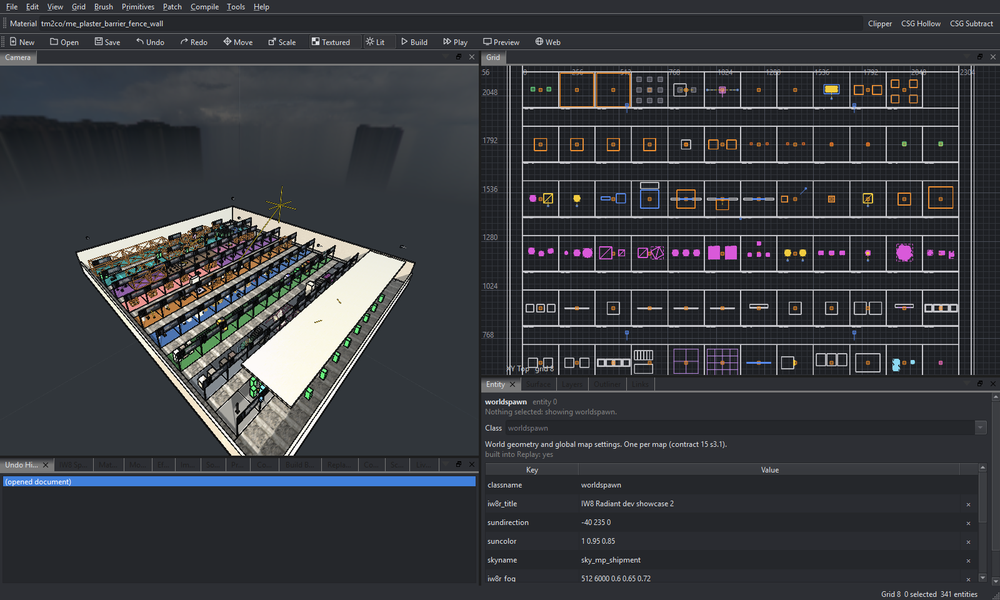

### Camera

- The 3D camera uses Direct3D 11 and shows textures. Right-click without moving to open a menu: select under the cursor, move the selection here, add a shape model here, copy the position, drop to floor, enter a prefab, and set the camera speed and field of view.
- End centres the camera on the selection.
- Camera bookmarks: Ctrl+1 to 9 go to a bookmark and Ctrl+Shift+1 to 9 save one. Bookmarks are kept per map. (owner confirmed)
- Four-view layout: `View > Four-View Layout` shows the camera, top XY, front XZ and side YZ together.
- Camera path: `View > Camera Path`. Add Key at Camera is Ctrl+Alt+K. Play and Stop are Ctrl+Alt+P. It has Loop, Speed, Clear, Save and Load (kept beside the map), and Export Frames, which writes a PNG sequence at 1920 by 1080. (owner confirmed in the editor)
- Export Camera Image: `File > Export Camera Image` renders the camera off-screen at 1080p up to 8K, or a multiple of the viewport. The clean option hides outlines, markers and tool faces.

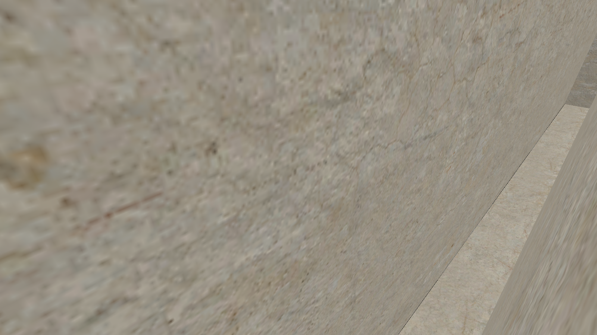

- Export Overview Image: `File` menu. It writes a top-down PNG.
- Export Turntable of Selection: `File` menu. It writes N views around the selection's bounds.

### Camera modes

- `View > Camera Mode`: Textured, Flat, Wireframe, Fullbright, Normals, Contents, Texel Density and Collision Only. (owner confirmed: every camera mode draws)
- Contents colours: structural grey, detail green, non-colliding blue, weapon clip yellow, brush entities purple and patches teal. (owner confirmed)
- Texel Density colours each brush face by texture pixels per unit against a target of 2 pixels per unit (green on target). (owner check pending)
- Collision Only shows structural and detail brushes, player clips, patches and placed models. Triggers and markers are hidden.
- `View > Selection Highlight` sets the colour and strength of the selection tint.
- `View > Texture Memory Budget` sets how much texture memory the camera may use (default 1024 MB). Past the budget, new textures load at a smaller size.

### Lit preview and sun

- Ctrl+L turns on the lit preview: the sun, the light entities (per pixel, with radius and cone), and sun shadows. A yellow arrow shows the sun direction. (owner confirmed: the lit preview matches the game)
- `View > Lit Preview Brightness` sets ambient, sun, light and exposure values. The values are saved. They were calibrated against the game.
- Normal maps and gloss: `View > Normal Maps and Gloss` toggles the shading from the packed `_n&_g` images. (owner confirmed in the editor and in game)
- Emissive materials (screens, lamps, signs) glow on top of the lighting in the camera.

### Fog, grade, wind and behaviour in the views

- `View > Fog Preview` shows the fog from the worldspawn fog keys in the camera.
- `View > Colour Grade Preview` shows the film grade (worldspawn `iw8r_film`) and the grading LUT (`iw8r_lut`). The film grade was confirmed in game (see section 6). No game check of the LUT is recorded.
- `View > Wind Preview` makes alpha-tested plant materials sway in the camera. The preview only. The builds do not write this motion yet. (not yet seen in game)
- `View > Behaviour Preview` moves the models and brush models that the build moves in game: spin and bob models, lift, bob, door and yaw spin brush models. Doors open, hold and close in a loop. User scripts are not previewed. (owner check pending)
- `View > LOD Preview` draws each stock model at the level of detail its camera distance selects. (owner check pending)
- `View > Heat Map` colours the top view by light overlap (`Light Overlap`) or spawn density (`Spawn Density`). See sections 5 and 6.

### Show what the build made

- `View > Show Compiled Collision` draws the last build's collision hulls: solid cyan, player clip orange, ladder green. (owner confirmed the outlines; the ladder overlay was not seen in the dev map)
- `View > Show Compiled World` draws the render triangles of the last build in magenta.
- `View > Show Navigation` draws the navigation mesh that the last build made (areas, nodes and links). Blockers and traversal authoring are not built.
- `View > Entity Display` shows names, facing arrows and model origin crosses. Connections between `target` and `targetname` are drawn in the 2D views.

### Textured camera

- Textures come from custom materials, from stock assets exported by ACTS, and from the material cache. Images are fetched when first needed. (owner confirmed stock textures)
- A stock sky is drawn around the map as an unfogged box (worldspawn `skyname`).
- Blended materials (glass, additive and other blended stock materials) draw after the opaque ones, farthest first. Custom materials marked `"blend": true` also draw blended.
- The camera shows the reflection probe nearest to the camera on glossy surfaces. One probe is used at a time.
- Play preview: press P in the camera to walk the map. W, A, S and D move. Space jumps, and at a ledge it mantles. Shift sprints. C crouches (sprint and C slides). Z goes prone. N is noclip. Esc leaves. Ladders are climbed by walking into them. (owner confirmed: play preview, ladder and mantle)

### 2D views

- XY, XZ and YZ grid views with edge coordinates and major and minor lines.
- Entities are drawn as point boxes with facing arrows and class colours. Player-sized spawn boxes are 32 by 32 by 72 units.
- Stock reference geometry can be shown as a backdrop in the 2D views. See section 11.

## 3. Materials and textures

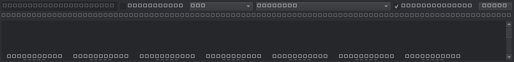

### Browsing and placing materials

- The Materials dock (`View > Materials`) lists stock materials. Search, favourites, recent, #tag lists, usage counts and All, Favourites and Recent tabs are there. (owner confirmed: browser filters)
- Status marks show cached, not cached and not in Replay. The Buildable only filter hides what cannot be built.
- Kits: a Kit filter groups stock materials into families such as containers, foliage, urban props and interiors.
- In this map: a filter that shows only the materials the map uses.
- Thumbnails: every stock material with a colour image has a thumbnail. A prebuilt pack holds 29,650 material thumbnails in about 74 MB.
- Apply a material: click it in the dock to apply it to the selected brushes, patches and models, in one undo step.
- Drag a material over a brush, patch or model in the camera. While you drag, the object under the cursor shows the material. Drop to keep it, or move away to undo the preview. (not yet seen in game: the grass material showed on the staircase cubes in the third playtest. The drag preview and the fix for models that the player could not collide with are not yet seen in game.)
- Replace Everywhere With: right-click a material to swap it on every face that uses it, or a model on every entity that uses it. One undo step.
- Replace a Material in the Whole Map: `Tools` menu. Every face and patch that uses one material takes the current one. Model keys follow.
- Replace One Material of the Selected Model: `Tools` menu. It sets the key `iw8r_mat:<material>` on the model, for one slot only. Model Info lists the slots. (not yet seen in game)

### Stock materials and textures

- Type any stock material name, for example `tm2co/me_curb_stone_01`. The editor exports its images with ACTS on first use. A texture can take a few seconds to appear.
- Builds use the stock colour image. `Compile > Stock textures` turns the cached stock colour images into build materials. (owner confirmed in game: each stock texture on the test pillars)
- Normal and gloss maps for stock materials come from the cached packed `_n&_g` images. `Compile > Stock textures` also writes them. (owner confirmed in game: stone, wood and metal show bump and gloss)
- Cut-out materials, such as chain-link fence and foliage, are recognised and built alpha-tested. (owner confirmed in game: the chain-link is see-through)
- A material whose image is not in the cache yet builds grey once. The next build has the image.
- Stock material tints: a stock material can tint its colour image. The tint is baked into the build and shown in the camera. The traffic cones were grey before this fix. (not yet seen in game)
- Surface types: the stock materials use the surface type that the game gives them. Footstep and bullet impact sounds follow it. Bullet impacts still looked alike in game in the second playtest. The cause is not known. (not yet seen in game)
- Stock materials by name: the build can reference a stock material by name only where the game can load it. Stock world materials from other maps are carried as copies (roadmap row 4.9).

### Custom textures and materials

- File > Import Texture writes a `.iw8mat.json` definition in the map's `materials` folder. It accepts PNG, TGA, JPG and BMP. The build writes a BGRA8 DDS with mips. (owner confirmed in game: a custom texture and a custom model)
- File > New Custom Material and File > Edit Custom Material open the Material Editor. A definition has a colour image, a normal image, a specular image (gloss in its alpha), a surface type for footsteps and impacts, alpha test or blend, two-sided, and the texture size in world units.
- Shader presets in the Material Editor: opaque, cut-out, blended, additive glow, multiply, decal, unlit sign and emissive. (not yet seen in game)
- Blend mode, unlit, emission (0 to 64), tint (0 to 4 for each of red, green and blue), decal sort order (higher draws on top) and depth offset (0 to 2). The build writes them as the converter reads them. (not yet seen in game)
- Live material preview: the Material Editor shows the material on a sphere, a plane or a cube, with a movable sun, exposure, spin and drag to turn. It follows each shader control. It is not the game's renderer: it has no shadows, probe reflections, fog or colour grade.
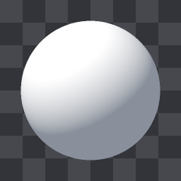

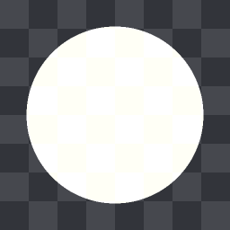

- Tools > Make Editable Copy of the Current Material: copies a stock material's colour, normal and specular images and a definition into the map's `materials` folder, with the tint applied. It opens in the Material Editor. (tested offline only)
- Tools > Adjust Image: brightness, contrast, saturation, hue, gamma, tint, invert, channel swap and resize. It can make a normal map from a height image. A preview shows the result before you save a new PNG. (tested offline only)
- Tools > Techset Info: explains the material's technique set (the shaders), by exporting it once through ACTS. The state words are not decoded. The export has not been run by a test.
- Material Info: Ctrl+Alt+M, or right-click a material. It shows the kind, use in the map, surface type, zone, technique set, the colour, normal and mask images with their sizes, what the build carries, and a texture table by slot. (owner check pending)
- Texture streaming: Material Info shows whether a texture's full mips are streamed. The build warns when a stock material would be built from a smaller cached image. (not yet seen in game)
- UV editor: `Brush > UV Editor` shows brush faces with vertex handles. Shared corners move together. Unwrap lays brushes out as nets. Patches show their control grid in UV space, with a handle per control point. Apply is one undo step. (owner check pending)

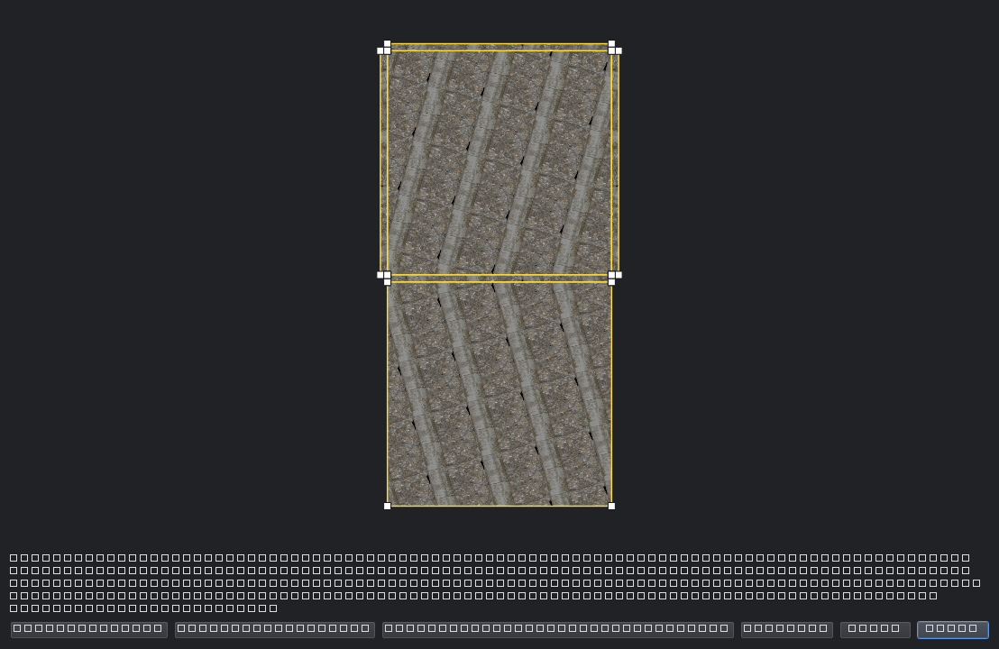

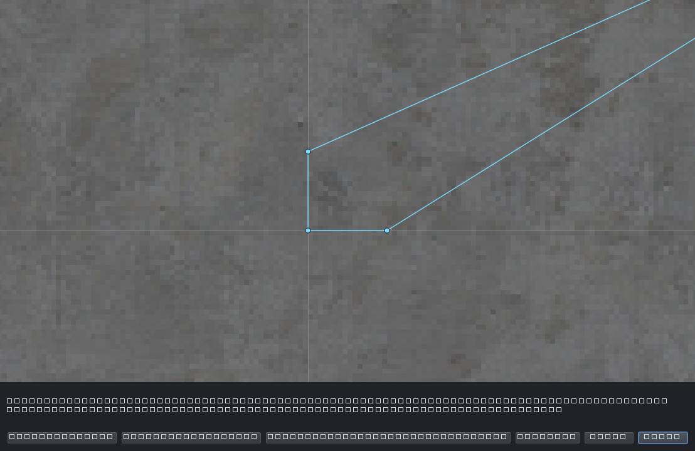

## 4. Models and prefabs

### Models

- Models browser (`View > Models`): search, a shaded 3D preview with triangle count, size and zone, and placement by double-click or by drag into the camera. (owner confirmed: the model browser)
- Place a model: a `script_model` or `misc_model` with its `model` key set. Stock models are exported with ACTS for the camera view and built into the map as textured copies named `iw8r_stock_*`.
- The catalogue lists the stock models. 6,490 are buildable. Missing ones show the reason in the tooltip.
- Custom models: File > Import Model reads `.obj`, `.glb` and `.gltf`. The model is copied next to the map. Multiple LODs, a collision mesh and material assignment are supported. (owner confirmed in game: a custom model). The glTF winding check in game is open.
- Collision: every placed model without a `targetname` gets an invisible solid box for players and bullets. A `script_model` with a `targetname` is scripted and gets none. (owner confirmed in game: stock models block the player and bullets)
- Convex hull collision: placed models get up to four convex pieces of collision. Tested on an L-shaped model. (not yet seen in game)
- Model Info: Ctrl+Alt+I, or right-click in the Models browser. It shows placements, zone, size, bounds, LOD0 surfaces with materials and triangle counts, every LOD with the distance it is drawn to, the collision LOD, bones and tags. (owner check pending)
- LOD preview: see section 2.
- `lod_scale` on a `misc_model` changes the distance at which its detailed model draws. (owner confirmed in game)
- `no_shadow` 1 on a `misc_model` stops it casting a light or sun shadow. (owner confirmed in game)
- `ground_lighting` on a `misc_model` lights it from the ground. (owner confirmed in game: the box is lit reddish)
- Materials on a model: the `iw8r_material` key replaces every slot. The build makes a copy of the model with that material. Custom models get the same treatment. (owner confirmed in game: the grass texture on the cubes in the third playtest)
- Scatter Models: `Tools > Scatter Models` places models in a radius. Model Paint Mode places N static models within a radius of each click, with random yaw and scale. (tested offline only)
- Scatter rules: `Tools > Scatter`. Rules by slope and material, density, minimum spacing, tilt to the surface and a seed. JSON presets are kept. (tested offline only)
- Drop Selection To Floor: `Tools` menu.
- Make Destructible: `Primitives > Scripted Objects` makes a model that breaks after 40 damage, with sparks. (not yet seen in game)
- Animated models: `iw8r_anim` on a live `script_model` plays a stock animation. (not yet seen in game)
- Spin and bob: `iw8r_spin` and `iw8r_bob` on a `misc_model`, `script_model` or `script_brushmodel` move the model without script. (owner confirmed in game: the crate spins and the crate bobs)
- Dynamic props: a `dynamic_prop` becomes physics clutter. (owner confirmed in game: the traffic cone moves when shot or pushed)

### Prefabs

- A plain prefab is one `.map` file with brushes and entities only. It still works as before.
- A prefab bundle is a folder named `<name>.iw8prefab`. It holds the brushes and entities with all their keys, the mapper's own materials, models, sounds and effects, an optional script, a title, a description, tags and parameters. Stock assets are named, not copied. The folder layout is in `docs/PREFAB_BUNDLES.md`.
- The Prefabs dock (`View > Prefabs`) lists bundles first, then plain prefabs. Each has a picture. A bundle has a BUNDLE tag. Hold the mouse over one to read its description, tags and parameters. The filter box searches title, tag, category and id.
- Picture of a prefab: the bundle's own `thumb.png` when it has one. Otherwise the picture is drawn from its contents. Triggers and clips are dashed outlines. (not yet seen in game: the dragging and the pictures of models were changed after the second playtest)

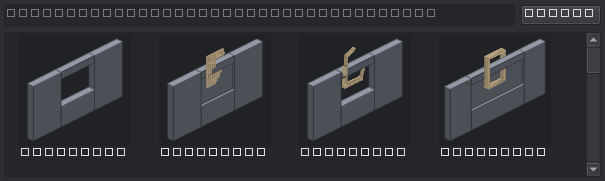

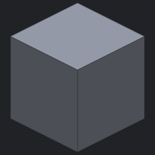

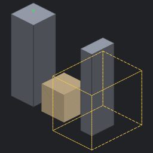

- Badges on a picture: FALLBACK (the build makes the second set of contents), LIMITED (a needed build feature is missing and there is no fallback), MISSING (a stock asset is not in the editor's catalogue) and CANNOT PLACE (the bundle cannot be read; the tooltip says why).

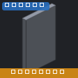

- Place a prefab: drag it from the dock into the camera or a grid view, or double-click it to place it at the middle of the camera view. (not yet seen in game: dragging was switched back on after the second playtest)
- Each placement is one `misc_prefab` entity with its own short id, the `iw8r_pid` key (for example `p3`). The id keeps the names of two placements apart. Copies get new ids.
- Parameters: select a placement and open the Entity dock. The bundle's title, description, badge and reason are shown above the keys. Each parameter has a field with its range and default. The Default button removes the value.
- Save Selection As Prefab (File menu): fill in the title, description, category and tags. The dialog lists what travels with the prefab: brushes and entities, the mapper's own files, stock assets by name, names that are kept apart per placement, and linked objects outside the selection. Tick a linked object to add it. Saving again under the same id asks before it replaces the bundle. Existing parameters, script and fallback settings are kept.

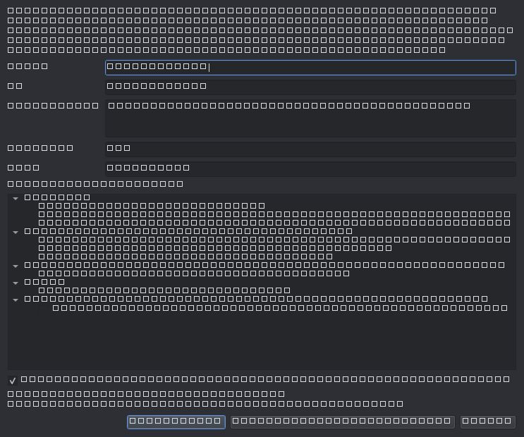

- Entity dock panel for a bundle placement: the title and description, then one field per parameter, with buttons below.

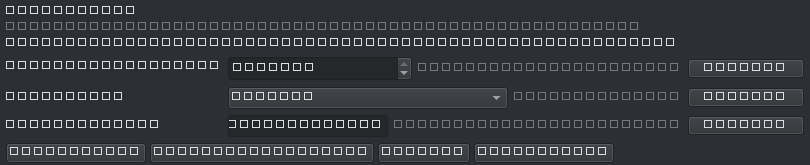

- Edit > Enter Prefab (Ctrl+Shift+E) opens the prefab's map to edit it. Leave Prefab (Ctrl+Shift+Q) returns, and every placement shows the change.
- Explode Selected Prefab replaces a placement with its loose contents. A bundle's names get the placement id in front.
- Make Selected Prefab Unique copies the prefab under a new id and points this one placement at the copy. The map must be saved first.
- Open Bundle Folder of Selected Prefab shows the folder in Explorer.
- Per-placement overrides: a `misc_prefab` can carry `iw8r_ovr:` keys and `iw8r_mat:` keys to change the contents of one placement. File > Prefab Parameters lists every key of every prefab entity, with this placement's overrides. (tested offline only)
- Save Selection As Plain .map Prefab writes the old single-file form. Insert Prefab places a `.map` file or a bundle.
- Names per placement: a name that is local to the prefab becomes `<placement id>_<name>`. A name in the global list is never changed.
- Scripts in a bundle: one script per prefab kind, started once per placement. Its functions start with `prefab_`.
- Fallback contents: a bundle can carry a second set of contents. The build uses it when a needed build feature is missing. The build log says which set was built.

Shipped bundles:

- Jump pad with effect and sound: a manhole cover model, a trigger that throws the player up (`iw8r_jump`), a pulse effect and a hum. One parameter, the launch speed. (the jump pad behaviour was confirmed in game on a test map; the bundle itself is not yet seen in game)
- Stock door, painted wood, single: the wooden door of Talsik Backlot. With `Edit > Preferences > Real stock scripted objects` on, it is built as the game's real door (not yet seen in game). With it off, it is built from the stock door's own model and sounds, with a script, and the badge is FALLBACK.

### Models inside prefabs

- In the camera, a prefab's brushes are drawn in flat colours. Models and other point entities inside it draw as their real models (roadmap row 3.11). The bundle format notes still list this as open, so the sources differ on it.
- Placement hints (`placement.surface` and `placement.yaw_step`) are read by the bundle format but not used yet.

## 5. Entities, spawns and game modes

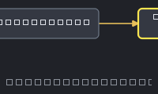

### Entities and keys

- Entity inspector (Entity dock): edit, add and remove keys. Each change is undoable. Help text for each key comes from the entity definitions. Missing required keys can be added. An invalid value is tinted.
- Entity definitions: 98 classes, each with key docs, defaults, sizes and colours. Check Map checks them.
- Class dropdown and key suggestions come from the IW8 class list.
- IW8 key names are shown as names, and the numeric key spelling of stock entities is kept when you save.
- Help > Entity Class Reference lists every class, generated from the definitions.
- docs/KEYS_REFERENCE.md lists the `iw8r_` keys by entity class, each with its value format and an example.
- Links dock: target and targetname chains (and `script_linkto` chains) shown as a layered node view. Problems are red. A click selects, a double-click centres the camera. Select Linked is Ctrl+Shift+L.
- Unknown keys and entities are kept as written when the map is saved.
- Check Map and Map Doctor (`Tools` menu) list findings. Map Doctor has a fix for some of them, applied with Fix Selected or Fix All. For example it moves a spawn onto the floor or repairs a dangling `target` key. Fixes are never applied on their own. (tested offline)

### Spawns

- Player spawns: the editor knows all 39 stock spawn names. Team, free-for-all, domination and Warzone start spawns are placed as entities. (owner confirmed in game: you spawn on the spawns row in team deathmatch, deathmatch and domination)
- Check Map warns when start spawns can see enemy starts, when spawns are closer than 128 units, and when team starts are closer than 1,024 units on average.
- Heat Map > Spawn Density colours the top view by how crowded the spawns are.
- Tools > Generate Spawns builds a spawn set over the walkable floors. Free-for-all, team and domination spawns are placed by farthest-point spacing. Allies and axis starts go on opposite sides. The command `iw8r generate-spawns` does the same.
- Stock map spawns can be made into entities and moved: File > Edit Compiled Spawns. See section 11. (not yet seen in game)

### Triggers

- Primitives > Triggers: multiple, hurt (damage 25), use, use-touch, and radius (a point entity with a radius and height). The trigger is made on the selection bounds or on a 128 box. One undo step. (owner confirmed: trigger placement)
- The `trigger_damage` class is listed but disabled. The converter drops it.
- Callout zones: Primitives > Triggers > Callout Zone makes a `trigger_multiple_bcs_<area>` volume. Check Map warns on bad names, empty boxes and overlapping zones.
- Triggers are tested by the map script. Jump pad and teleporter triggers work in game (owner confirmed). The hurt trigger fired but did no damage in the second playtest. The radius damage call that replaced it is not yet seen in game.

### Game mode objects

- Primitives > Game Modes inserts eight templates as one undo step: Domination flags, Hardpoint zones, Search and Destroy sites with the bomb, CTF flags, and four spawn sets. The trigger sizes are placeholders. The flag prop, the chevrons and the in-game behaviour are not yet seen in game.
- Primitives > Game Modes > Match Cameras inserts the intermission camera (`mp_global_intermission`) and a `camera_intro` struct. Whether Replay 1.20 uses `camera_intro` without a label is not verified.
- The build writes the list of modes the map is for into the package's `map.json` (`gameTypes`). A mode is listed when the map has the spawns and objects for it. Team Deathmatch needs two `mp_tdm_spawn` and a start for each team. Domination needs domination spawns, both starts and the three flags. Search and Destroy needs attacker and defender spawns, two bomb sites, the bomb and its pickup trigger. Capture the Flag needs CTF spawns, both starts, and flag, trigger and zone for both teams. Free-for-all needs two `mp_dm_spawn`.
- Map Info (Compile dock) has a Game modes field. For example `war conf` adds Kill Confirmed. The editor cannot check modes it does not know.
- Only Team Deathmatch could be picked in the game's lobby in the second playtest. The fix is in a new local client build that has not been run in game. (not yet seen in game)

## 6. Lights, sky, fog and colour grading

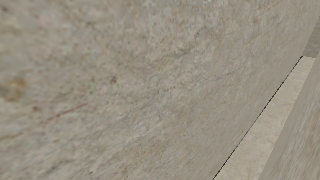

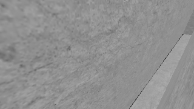

### Lights

- Light entities (`light`, `light_spot` and `light_omni`) become primary lights. Keys set colour, intensity, radius, cone and shadows. (owner confirmed in game: coloured omni and spot lights light the floor)
- A spot with a cone of 150 degrees or more is built as an omni light. The build log notes it. One light whose values were changed did not show in game before this. The cause is not known. (not yet seen in game)
- More light keys: `iw8r_bulb_radius`, `iw8r_shadow_bias`, `iw8r_falloff`, `iw8r_fade`, `iw8r_shadows`, `iw8r_intensity_units`, `iw8r_uv_intensity` and `iw8r_ir_intensity`. (not yet seen in game)
- IES profiles: the `iw8r_ies` key takes an LM-63 `.ies` file. Tools > IES Profile Browser lists a folder's profiles with a polar plot, and sets the key on the selected lights in one undo step. (not yet seen in game)

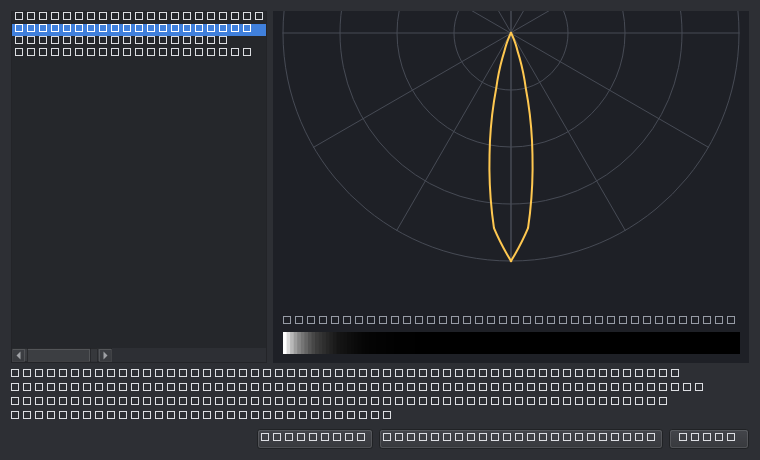

- Reflection probes: a `reflection_probe` is an oriented-box volume with priority and feather. Compile > Capture Reflection Probes takes captures from the editor camera. Probes are captured before every build now. (not yet seen in game: the probes made no visible change in the playtests)
- Light budget: Check Map reports light budget errors and warnings. Heat Map > Light Overlap colours the top view where too many lights reach a cell.
- Light grid: every build writes a light grid with an ambient colour. Viewmodels, players and models light from it. (owner confirmed in game: the viewmodel is lit normally)
- Lamp prefabs carry their light entities with the model.
- Emissive materials glow in the camera. See section 3.

### Sun and sky

- Compile > Sun & Sky sets the sun pitch, yaw and colour, and the stock sky (`sky_mp_*`). The sky is exported with ACTS and converted at build time. With Compile > Aim the Sun When the Sky Changes on, a sky change also aims the sun at the sun painted in that sky. (owner confirmed in game: the shadows point the same way in the editor and in game, after the north fix)
- Compass: the north of the compass is the top of the XY view (+Y). Builds write worldspawn `northyaw 90` unless the map sets its own. (owner confirmed in game)
- Sun From Sky aims the sun at the sun painted in the chosen sky.
- Compile > Time of Day: Clear Day, Overcast, Dusk, Night and Interior set the sun, sky, fog, film grade and exposure in one undo step. Shift keeps the sky. (not yet seen in game)
- Sun shadow range: worldspawn `iw8r_sun_shadow_range` sets how far sun shadows reach. (owner confirmed in game: far shadows)
- Sun sprite and flare: worldspawn `iw8r_sun_sprite` sets the size, flare and glare of the sun disc. (not yet seen in game)
- Custom sky from a panorama: Compile > Sky From Panorama takes a PNG, JPG, TGA or Radiance HDR image, with rotation and exposure. It writes the sky, sets `skyname`, and can aim the sun at the brightest spot. (not yet seen in game)
- A heightfield is built from the opaque world triangles and the sun-shadow casters. Rain is not drawn under roofs with it. (not yet seen in game)
- Sky preview: the textured camera draws the worldspawn sky. (owner confirmed: sky)

### Fog, colour grade and vision

- Compile > Atmosphere sets exponential fog (start, halfway distance and colour) and the film grade. Exposure is in Map Info. (owner confirmed in game: sky, fog and film grade)
- Colour grade (worldspawn `iw8r_film`): contrast, brightness, desaturation, invert and light and dark tints. (owner confirmed in game: film grade)
- Grading LUT (worldspawn `iw8r_lut`): a `.cube` file applied last in the camera shaders. No game check is recorded.
- Compile > Vision Editor lists all 218 vision fields by name, with type and default. The values you set are the `iw8r_vision` overrides of the map. Only 87 fields have readable names. The others are listed by token. (not yet seen in game)
- Vision volumes: a trigger brush with `iw8r_vision` "field=value; ..." and a targetname gives its players their own vision while they are inside. (not yet seen in game)
- Volumetric box: Primitives > Volumetric Box writes a world volumetric with density, falloff, colour, height fade and anisotropy. (not yet seen in game)
- Decal volumes: the point entity `iw8r_decal` sets origin, angles, size, material, opacity, feather, draw order and UV keys. A decal can name a stock material or a custom material. (not yet seen in game)
- Decal tool: Brush > Decal Mode projects the current material onto a surface with a click. Brush > Place Decal on Selected Face places one on the selected face. (not yet seen in game)

## 7. Effects and sound

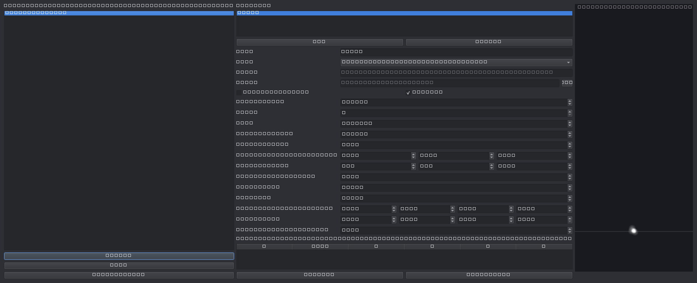

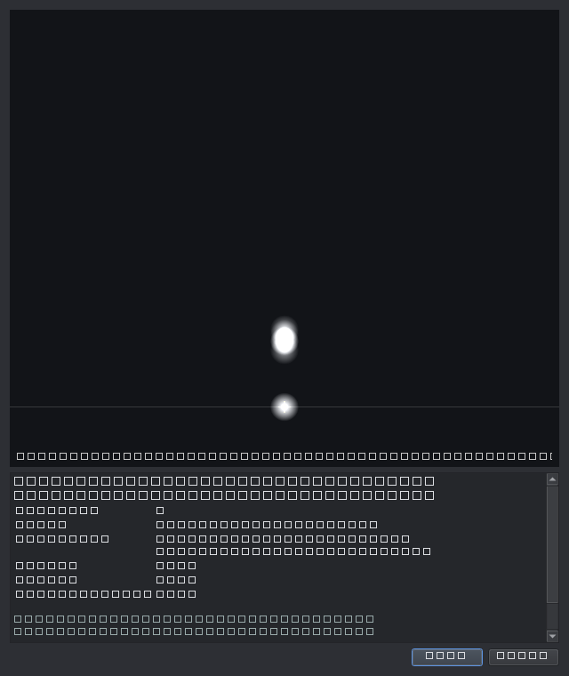

### Effects

- An `fx_origin` entity with an `fx` key (a stock `vfx/...` name) plays that effect. `angles` and `delay` are optional. With no delay the effect plays once and stays, for example a fire. The build writes the calls into the map script. (owner confirmed in game: stock effects)
- The Effects browser lists 1,020 effects from the common zones. Double-click or drag one to place an `fx_origin`. (owner confirmed: drag and drop of effects)
- Effect Info: right-click an effect. It shows the emitters, one-shot or looping, run time, materials, models, sounds, child effects and the simulated bounds. It also has a simplified particle preview. (owner check pending)
- View > Effect Preview in Camera plays every `fx_origin` effect in the textured camera.
- Tools > Effect Editor builds the map's own sprite effects. Each element has an image or a soft default particle, blend (blended or additive), looping or one-shot, size and colour from start to end (curves with 2 to 16 keys), velocity, gravity and count. The effect is saved as `<map>/fx/<name>.iw8fx.json`. Place in Map puts an `fx_origin` with it at the middle of the view. Light elements and model elements are also written. Decal and runner elements are not covered. (not yet seen in game: a test campfire effect was not visible in the playtest)
- A looping authored effect is played again by the map script about once a second. (not yet seen in game)
- Sound on an effect: the `soundalias` key plays a sound at the effect. It loops unless `sound_loop` is 0. (not yet seen in game: the campfire hum was not heard in the second playtest)
- Damage on an effect: `iw8r_damage` on an `fx_origin` takes `<amount> [radius] [interval]`. A player in the radius (48 by default) takes the damage every interval (1 second by default). (not yet seen in game)

### Sound

- The Sounds browser lists 11,707 sound aliases of the always-loaded banks. Loops show blue. Drag or double-click one to place a `sound_emitter`. (owner confirmed: drag and drop of sounds)
- The `sound_emitter` entity plays an alias at a point. Keys are `soundalias`, loop and delay. The map script starts it. (owner confirmed in game: a looping sound emitter, and the random ambient chirps)
- The wind-like ambient bed plays everywhere. (owner confirmed in game)
- The 220 Hz hum from the centre of the test map was not noticed in the playtest. The gain of converted looping sounds was corrected offline after that. The fix is not yet seen in game.
- Tools > Sound Settings sets the volume, distances, loop and 2D or 3D mode of one of the map's own sounds. The settings are kept in `<name>.iw8snd.json` beside the sound. (tested offline only)
- Custom sounds: WAV and MP3 files in the map's `sounds` folder become aliases of the map bank. `iw8r_ambient` gives a 2D looping bed to a zone, and `iw8r_ambient_oneshots` gives timed one-shot sounds. (not yet seen in game)
- Reverb zones: worldspawn `iw8r_reverb` sets a map-wide room type. A trigger brush with `iw8r_audio_zone` makes a zone that changes the reverb while a player is inside. Reverb is not confirmed in game. (not yet seen in game)
- Interior occlusion: `iw8r_audio_interior` 1 gives a zone the interior occlusion presets.
- PA speakers are not built. The stock multiplayer maps do not use them. Custom music states are not built.

## 8. Scripting and behaviours

### Script dock

- The Script dock (`View > Script`) edits the map's own script. File, New Script creates `<map>.gsc` and sets worldspawn `iw8r_script`.
- Syntax colours and completion from 3,009 IW8 built-in names.
- Check looks at brackets, strings, comments, `user_main`, reserved names and `#include` lines. Each message has a line you can click.
- The build appends the map's script after the generated map script. A line of the generated part is mapped back to the mapper's own file. gsc-tool errors in the Compile log open the Script dock on the line. (not yet seen in game: the spin script on a stock model gave an error; the owner's fixed script compiles)
- Insert Behaviour (Script dock): sliding door, rotating door, lift, teleporter, jump pad, spinner, timed effect, trigger message, and HUD message and icon. Each compiles with gsc-tool. (not yet seen in game)
- Trigger calls for your own script: `iw8r_trigger("name")` returns an object that is notified with `"trigger"` and the player. `iw8r_in_trigger(player, "name")` tells you whether a player is inside the trigger.
- HUD message and icon: a map script can set HUD text and an icon from stock names. (not yet seen in game)

### Keys that make things move or act

Each key goes on the entity named. The keys are listed with examples in docs/KEYS_REFERENCE.md.

- `iw8r_spin` and `iw8r_bob`: see section 4. (owner confirmed in game)
- `iw8r_teleport` on a trigger takes the targetname of a `script_origin` as its destination. (owner confirmed in game: the teleporter)
- `iw8r_jump` on a trigger, for example `0 0 700`, launches a player who touches it. (owner confirmed in game: the jump pad)
- `iw8r_damage` on a trigger, for example `10 1`, hurts a player inside it each second. The second playtest showed no damage. The radius damage call is not yet seen in game. (not yet seen in game)
- `iw8r_lift` on a `script_brushmodel` with a targetname, for example `128 2 2`, moves it up, waits and comes back. (not yet seen in game)
- `iw8r_door` on a `script_brushmodel`, for example `rotate 90 1 3` or `slide ...`, opens it. The door needs a `trigger_use` or a `trigger_multiple` with its own targetname that targets the door. A brush model that moves is drawn by a generated model that the build links to it. Set `iw8r_brush_visual` to 0 to turn that off. (not yet seen in game)
- Hinged door: Primitives > Scripted Objects > Make Hinged Door. The door swings about a hinge at one end, away from the player who presses Use near it. It stays open until used again. `iw8r_hinge` moves the hinge. `iw8r_door` takes `hinge <angle> [time]`, `rotate <angle> [time] [hold]` or `slide`. (not yet seen in game)
- Make Glass Pane: Primitives > Scripted Objects. It turns the selected thin brushes into a `script_brushmodel` named `glass_N` with the blended `iw8r_glass` material. The build replaces it with Replay's breakable glass. (owner confirmed in game: the pane is see-through after the fix; breaking was reported in the first playtest)
- Make Ladder: Primitives > Scripted Objects. It makes a thin climbable slab through the rungs, and a ladder model with no player collision (`iw8r_no_collision`). The ladder tower was climbed in game in an earlier test. The rebuilt ladder is not yet seen in game.
- Make Scripted: Primitives > Scripted Objects. It makes a live object for the map script.
- `iw8r_anim` on a live `script_model` plays a stock animation, with `iw8r_anim_loop` for looping. (not yet seen in game)
- `iw8r_vision` on a trigger switches the player's vision. (not yet seen in game)

### Scriptable objects

- A `scriptable` entity with its `scriptable` key set to a stock definition name places one of the game's own objects with built-in behaviour. `hardpoint_chevron` and `scriptable_auto_ascender` are always loaded. (not yet seen in game)
- The Warzone buy station `br_plunder_box` can be placed on a map made for the Warzone game type. See section 12.
- Stock objects such as doors, cones, cars and fences come from stock map files. With `Edit > Preferences > Real stock scripted objects` on, the build copies the definition with its models, collision and materials. The test checklist and the user guide give the default as on. The roadmap (row 6.14) says off by default. (not yet seen in game)
- The catalogue `data/asset_catalog/iw8_scriptables.tsv` lists all 837 stock definitions. Its column `verified` says whether each can be built. Research 89 counts 509 as buildable.
- Check Map names the stock scripted objects a map has and whether each stock script can run in a custom map. This is a reading of the stock scripts. It is not a game test.

### Dynamic entities and physics

- A `dynamic_prop` becomes physics clutter. It rests until something disturbs it. (owner confirmed in game)
- Script models and dynamic props block players. (not yet seen in game: the owner's check of this was not ticked)

## 9. Building and deploying the map

### Build steps

- F7 builds the map. It runs the native extraction (the editor's compiler), then x64-zt builds the zones, then ACTS validates them. Warnings are listed and are not fatal.
- Shift+F7 runs the extraction only.
- Ctrl+F7 builds and deploys the package into the game's custom map folder, `mods\mw120r\maps\<id>`. Deploy works while Replay runs, except for the map that is loaded. The previous package is kept, and Compile > Undo Last Deploy restores it. The deploy stages the files, checks each with SHA-256 and keeps a backup. It has been tested on a scratch game folder only.
- F5 builds, deploys and loads the map. See section 10.
- Build preflight: a step after the extraction checks what would fail in game. It looks at materials and images the build does not carry, models, unknown GSC calls (with their line), `main()` and brackets. Errors stop the build when the setting `compile/preflightBlocks` is on. The CLI command `iw8r preflight` runs it alone.
- Incremental builds: unchanged files are not written again. When the extraction is the same as the last checked build, the zones are reused and the zone and validate steps are skipped. Compile > Force Full Rebuild turns this off. The build log ends with a time report for each stage.
- Build report: after every build, the Compile log lists the assets by type and size, and what changed since the last build. The CLI command `iw8r report` does the same.
- Zone Dependencies (Compile > Zone Dependencies): which stock zones the map relies on, and which stock copies could be referenced instead, with the space saved.
- Build Budget dock: the last build's figures as bars against their limits (image memory, largest image side, world triangles, static models, entities, primary lights, sun light index and script size). Green, amber or red.
- Map Info (Compile dock): title, description, compass rotation, minimap scale, ladders, exposure and game modes. The build writes these into `map.json`.
- Set Loadscreen From Camera (Compile): renders a clean 16:9 view into `<map>.loadscreen.png`. The build turns it into the package's preview image. (not yet seen in game)
- Leak Check (Tools): draws the leak path to the outside. The compile warns when there is a leak.
- Check Map (Tools): lists problems before a build. Examples are a spawn inside a wall, a missing model, and a link to a missing target.
- Log output: the Compile dock shows each step. Double-click a line in the Compile log or the Replay Log that names a `.gsc` line to open it in the Script dock.
- Tutorial: `docs/TUTORIAL.md` walks through `samples/tutorial/iw8r_tutorial.map`. It is an arena with a building, a ramp, cover, prefabs, a light, a probe, a sound, an effect, spawns and flags.

### Deploy and rollback

- Deploy refused: the message names the file in use. It is usually the map that Replay has loaded. Load another map first. An Explorer window on the map folder does not block a deploy.
- Compile > Undo Last Deploy restores the previous package.
- Compile > Launch Replay starts the game. It runs only when the owner starts it.

## 10. Live link and in-game testing

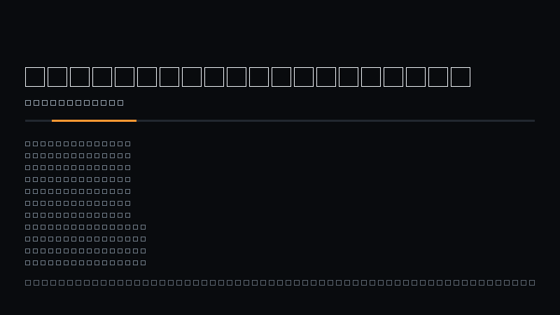

### Live Link dock

- Game link works with any executable in the game folder, including recompiled ones. It reads their address map. (owner confirmed: Live Link Direct reads the camera, follows the game and moves the player)
- Read camera -> editor: reads the player's view into the editor camera.
- Move player to editor camera: moves the player to the editor camera's place.
- Follow game: the editor camera copies the in-game view live.
- A console line sends any command to the game.
- Hot update: moved `script_model` and `script_origin` placements are sent to the running game. (owner confirmed: live hot channels)
- Hot channels in a new build: moving an `fx_origin` replays its effect at the new spot. Moving a `sound_emitter` plays or moves its alias. Editing the worldspawn sun direction or colour changes the sun in game. (owner confirmed in game)
- Lights, spawns and key changes are not hot. They need a rebuild.
- Load map in game: Compile > Load Map in Game (Ctrl+F8), or the Live Link button. It sends the load command for the compiled map. (not yet seen in game)
- Quick match: Live Link > Quick match picks a mode and bot counts, then starts a private match on the deployed map. From a lobby you host it starts with no countdown. From the Multiplayer menu it hosts a private match first. (not yet seen in game)
- Screenshot: Live Link > Screenshot grabs the game window into the Pictures folder. (owner check pending)
- Select What the Player Looks At (Compile menu): a ray from the player's eye selects the item. Move Selection to the Player moves the selection to the player's feet. Editor Camera to the Player's View sets the camera. (not yet seen in game)
- Camera sync: the editor sets the player's origin. The angles are not written. (not yet seen in game)
- Live atmosphere (sun, fog and vision pushed live) was removed. The live sun channel crashed the multiplayer client in an owner test.
- The editor's link works without the proxy DLL. The proxy sections of the dock appear only when that DLL is in the game folder.

### Debug overlay

The Live Link dock has a Debug overlay row. It tells the game to draw what the map contains. It needs the new local client build, which has not been run in game.

- Where am I: a panel with your position in map units, the map, entity counts and the audio zone.
- Entities and triggers: a label and an axis marker on each entity near you. Triggers get a wire box.
- Entities and crosshair: the same, plus the surface type, flags and entity you look at.
- Everything: a box on every entity that has bounds, players and AI included.
- A filter limits the labels. Selected filters to the entity selected in the editor.
- Compare with game: lists the named map entities that are missing in the match, in another place, or in a different number. It can move the editor camera to where you stand.
- The game console has the same options as the dvars `iw8r_mapDebug`, `iw8r_mapDebugDist`, `iw8r_mapDebugMax` and `iw8r_mapDebugFilter`, and the command `iw8r_mapDebugDump`.
- (not yet seen in game)

### F5 from a closed game

- F5 with Replay closed builds and deploys the map, then does the rest by itself. It picks the game executable (the launch path in Tool Paths, or the recompiled local client in the game folder).
- For the local client it checks the local online-services host. If the host does not answer, it starts it and waits up to 60 seconds.
- It starts the game, selects Multiplayer, hosts a private match, sets the map and Team Deathmatch, and starts the match with no countdown.
- A dark card with the map name covers the game window from the start. It closes when the map loading screen begins. The card never takes the keyboard or the mouse. Each step is listed in the Compile dock with the time since F5.
- Options are in Edit > Preferences, the F5 rows. They are stored in `IW8Radiant.ini`, section `[devmap]`. The keys are `gametype`, `cover`, `hostCheck`, `hostCommand`, `hostHealth`, `startRequest` and `bots`.
- (not yet seen in game)

### Testing in the game

- Help > Test Checklist lists the items of `docs/TEST_CHECKLIST.md`. Each item can be marked OK, Wrong or Not tested, with a note. Results are saved with the build and date. The editor shows a "seen in game" mark next to each feature that has one.
- The dev showcase map `samples/dev/iw8r_dev_showcase.map` has one labelled row per asset variation. Its checklist is in `docs/TEST_CHECKLIST.md`.
- Log access: Console dock (View > Console) and Replay Log dock (Compile > Show Replay Log).

## 11. Stock map editing

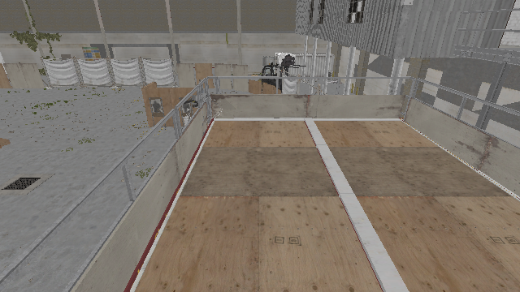

### Opening a stock map

- File > Open IW8 Stock Map lists the stock multiplayer maps that can be opened. The catalogue has 93 map ids, of which 37 are openable multiplayer maps. The entities of the map are the document. The world and props are shown as a reference.
- View > Stock Map Reference draws a stock zone's world, textured, as a backdrop in the 2D views. Props are drawn as their real meshes, or as boxes while their model is still being fetched. Instancing draws repeated props together.
- A stock map's props fill in over the first minutes. Props still loading are amber cubes. Failed ones are red. A status-bar label shows how many models are ready. The first open of mp_backlot2 took about seven minutes in the playtest notes. A later test measured about 30 seconds with an empty cache. (not yet seen in game)
- Stock map reference view has a limit: mp_donetsk loads only its main zone. Its streamed transient zones are skipped with a warning. Verdansk is a Warzone map with 749 streamed zones. The reference view loads one zone.

### Editing a stock map

- File > Edit Compiled Spawns turns the spawn points into entities you can move, add and delete. (tested offline; not yet seen in game)
- A script_model with any stock model works even when the model belongs to another stock map. The rebuild copies that model with its materials and textures. The Console lists what is copied. (not yet seen in game)
- File > Rebuild Stock Zone writes the changed zone in a few seconds. The converter (`editzone`) reads the stock zone into memory and writes it again. ACTS then loads it and checks it. The Console shows the result and the folder. The game folder is only read. (not yet seen in game)
- The rebuild also writes small patch files (`<map>.fp`) instead of a new zone. The game applies a patch beside the stock zone of the same name, so the stock zone is never replaced. (not yet seen in game)
- File > Install Edited Stock Map Into Game copies the patch files after a confirmation that lists them. A stock patch of the same name is saved first. Close the game first. File > Restore Stock Map In Game takes the edit out again. Only the owner runs these. (not yet seen in game)
- File > Hide Stock Props In Selection: draw a brush around props, select it and use this command. Each stock prop inside the selection leaves the view. The rebuilt map draws them at size zero. Collision stays. File > Show All Stock Props brings them back. The helper brush is not built into the stock map. Whether scale zero hides a model in game is not known. (not yet seen in game)
- File > Relight Stock Map (Fog / Vision) changes a stock zone's fog start, density, colour and maximum opacity. The rebuilt zone is checked by ACTS. (not yet seen in game)
- View > Stock Reference to Model: the stock triangles inside the selection bounds become a custom model, placed where they were. The copy carries the stock texture coordinates and materials. (not yet seen in game)
- View > Stock Reference to Brushes: each stock triangle inside the selection becomes a thin prism brush in one func_group, up to 4,000 brushes. The top face has the stock material. (not yet seen in game)
- File > Compare With Map shows what differs from another map: entities added, removed or moved, keys and worldspawn brushes. Save Patch and File > Apply Map Patch carry the difference. This works on any map. (tested offline)
- Stock warzone maps use the same edit command. See section 12.

### What an edited stock map cannot do yet

- New brushes inside the stock world are not possible directly. The planned route is to build them as a model with collision and carry that into the zone. Not built.
- New static models and new lights cannot be added to the stock world's own tables. A new prop is a `script_model`.
- The edited map keeps the stock map's name. A custom package with a stock map's name does not load, because the stock map of the same name always wins. So the edit is installed as a patch beside the stock zone.

## 12. Warzone and game modes

### Game mode presets

- Tools > Game Modes lists the mode presets. A mode is a game type script plus settings (dvars). The Warzone variants (Trios, Quads, Stimulus Solos and Blood Money) all use the script `br` with different settings.
- The list has 12 built-in presets: the six core game types, four Warzone variants, and two for small maps.
- Edit a preset, Save as my preset (kept as `<id>.iw8mode.json`), or Delete your own preset.
- Use for F5: F5 starts that game type. The editor sends the preset's settings before the match starts. (not yet seen in game)
- Carry in this map: the map sets its mode settings at every start (worldspawn `iw8r_mode_dvars` and `iw8r_br`). Use it for a map that is meant for one mode. (not yet seen in game)

### A small map in the Warzone game type

- Pick "Warzone on a small map", press Carry in this map, then Tools > Game Modes > Insert Warzone start entities. It makes eight starting spawns (`mp_dm_spawn_start`) and one prematch area at the 2D view centre. Move the spawns onto the floor.
- The build lists the map for `br` in `map.json`. The switches that a map without a circle, gulag or plane needs are set. (not yet seen in game)
- Vehicles are not built on a custom map.

### Loot

- Loot on your own map: `iw8r_loot_point` entities are written into the map's loot table. A free point is a point where loot can lie. With `loot_cluster` set to `cache` it is a supply box point. (not yet seen in game)
- Worldspawn `iw8r_no_loot` set to 1 removes all loot from the map.
- Loot on a stock map: File > Edit Loot Points turns the map's loot points into green `iw8r_loot_point` entities. mp_br_quarry has 2,924 points and mp_donetsk (Verdansk) has 23,446. Move, delete or copy them. The Rebuild Stock Zone command writes them back. A point that is moved out of its area finds its new cluster and zone by position. (not yet seen in game)
- Undo after Edit Loot Points cannot remove a map's loot by accident. Only `iw8r_no_loot` removes it.

### Buy stations and vehicles

- Buy station on your own map: a `scriptable` entity with `scriptable` set to `br_plunder_box`. The build places it by name on a map made for the Warzone game type. The build log says "1 scriptable instance(s) name a definition of the Warzone zone". Whether the game loads the Warzone zone for an own map is not known. (not yet seen in game)
- Buy stations on a stock map: File > Edit Placed Objects turns the buy stations (120 on Quarry and 120 on Verdansk) into `scriptable` entities. Move one, or copy one to add another. A station cannot be removed. Doors and other objects with moving parts cannot be edited this way yet. (not yet seen in game)
- Vehicle spawns are ordinary entities: `script_struct_mp_atv`, `_tacrover`, `_jeep`, `_cargotruck` and `_littlebird`. mp_br_quarry has 183. Copy, move or delete them, and the rebuild writes them like any other entity. Vehicles are not built on custom maps.

### Editing a stock Warzone map

- The stock map tools run on the Warzone maps. The entity edit and the rebuild take a few seconds on mp_br_tut and mp_br_quarry. (tested offline)
- The install for a Warzone map is the same as for any stock map: a patch file, installed by the owner. (not yet seen in game)

### Not built for Warzone

- New game mode scripts (a mode that is more than dvars) are not built. The engine loads `scripts/mp/gametypes/<name>.gsc`. Whether a script inside a map zone is found as a game type is not known. Behaviour in the map's own script works under every game type.

## 13. Asset tools

### Catalogues and checks

- Asset Availability Audit (Tools menu): re-runs the audit for models, materials, effects or images, and reloads the browsers. The recorded results: 6,490 models are buildable, 164 are missing. 1,020 of 1,020 effects are buildable. Materials are counted as ok, grey (no colour image) or missing (150). 44,502 images are buildable and 6,137 cannot be exported.
- Browsers hide what cannot be built when Buildable only is on. The tooltip gives the reason.
- Cache Manager (Tools menu): each cache folder with its size and files, Open Folder, Purge, a size cap for textures, meshes and previews (applied when the editor starts), and Move Caches to another drive. The caches are under the app data folder.
- Asset Usage (Tools menu): what the map uses of each kind, with counts. It lists the map's own files that nothing uses. (tested offline)
- List Unused Custom Assets (Tools menu).
- Check Map: a placed model whose stock model is missing in Replay is reported.
- Images dock: 50,639 catalogue images, exported with ACTS on first use and previewed.
- Sounds dock and Effects dock: see section 7.
- Material and model thumbnail packs: 29,650 materials (about 74 MB) and 6,490 models (about 13.5 MB). The browsers read them when no export of their own exists.
- The stock scripted object catalogue (roadmap row 6.13) has 952 stock entities of two maps, grouped in 68 kinds.

### Inspectors

- Material Info (Ctrl+Alt+M), Model Info (Ctrl+Alt+I), Effect Info, Techset Info and Asset Usage are described in sections 3, 4, 7 and 13.
- Stock asset exports are cached under the app data folder. The editor exports them with ACTS when first needed.

## 14. Packaging, sharing and web access

### Map packages

- File > Export Map Package writes a zip with the map, its prefabs (including the library prefabs), the custom materials and models it uses, and its sidecar files (loadscreen, camera paths and entity notes). (tested offline)
- File > Import Map Package extracts the zip into a folder, adds its prefabs as a prefab folder, and opens the map. Windows can read the zip.

### Release package and installer

- tools\package_release.ps1 builds the release folder with the editor, the command-line tool, the Qt runtime, the licences and the sample map. It needs the Visual C++ redistributable. The later package is about 74 MB, or 26 MB zipped.
- tools\build_installer.ps1 builds a per-user Setup program with Inno Setup. It adds Start menu and desktop shortcuts. Settings and caches are kept on upgrade and uninstall. A build was made on 2026-11-10 (13.4 MB). A test install on a clean machine is the owner's to do.
- Licences: Qt (LGPL) and Qt-ADS (LGPL) are included. No GPL data is shipped.

### Web access

- Tools > Web Server runs a local web server so the suite can be used from a browser. It can be turned on in Web Server Settings.
- The server is local only unless LAN access is turned on. Remote requests need a login or the session token. A login is locked for a time after eight failures.
- UPnP port mapping can be set up. The owner confirmed access from outside (roadmap row 10.1).
- The browser client has 2D top, front and side views, an entity list, an inspector, select and move, key editing, undo, redo, save, compile and a log. It fits a phone-width screen. (not yet seen in game)
- Live updates reach the browser as the document changes.
- A 3D view in the browser draws the textured scene with thumbnails.
- The browser can compile, deploy, build and play, load in game, and place assets.
- The web access work is paused. The owner asked for the desktop app to come first, on 2026-11-10. The server stays on for the owner.

## 15. Automation and command line

- Tools > Run Command Script runs a script of commands: select, set, remove, move, clone, delete, add, material, array, align, replace key, undo and redo. The script is one undo step, and it rolls back if one command fails. Scripts are loaded and saved as `.iw8cmd` files.
- Tools > Start / Stop Macro Recording records moves, clones, deletes and key edits of the selection. A drag becomes one line. The result opens in the Script dock.
- Help > Command Palette (Ctrl+Shift+P) runs any menu command by name. (owner confirmed)
- The command line `iw8r` has the commands `info`, `roundtrip`, `diff`, `edit`, `iw8-ents`, `report`, `preflight`, `sky-panorama` and `generate-spawns`.
- The editor also runs headless builds. `IW8Radiant.exe --compile <map> --out <folder>` builds a map without the window.
- Hotkey presets (section 1) can be switched and edited.

## 16. Help, settings and safety

- Help > First-Run Setup opens by itself when the Replay executable is not found. It finds the game folder and the executables in it (including renamed or recompiled ones), ACTS, Oodle and x64-zt. The Replay executable's hash is computed, but the window does not check it against the stock hash yet.
- Tools > Tool Paths sets the tool paths. These include gsc-tool, which compiles the map scripts.
- Edit > Preferences holds the F5 options, the prefab folders, the Real stock scripted objects switch, camera speed and field of view.
- View > Theme chooses Dark, Light or Midnight high contrast. An accent colour can be set. View > Customize Toolbar picks and orders the toolbar commands.
- Console dock (View > Console): every status line, compile line and warning, with level and text filters, Clear, Copy all and auto-scroll.
- Toasts: View > Toggle Toasts shows short notifications for warnings and errors.
- Help > Search Help (Shift+F1) searches the user guide, the tutorial, the entity reference, the test checklist and the feature matrix.
- Help > First Map Guide ticks off the tutorial's steps from the open map, with Do it buttons for the commands that help.
- Crash handler: a report with the stack and a dump is written to the crashes folder in the app data folder. The next start names the report in the status bar.
- Safe mode: start with `--safe-mode`, or hold Shift at start. Settings are default and nothing is written. Help > Restart in Safe Mode is also there. Help > Reset All Settings keeps a backup of the settings file.
- Autosave: unsaved changes are saved every 5 minutes to the autosave folder. File > Recover Autosave opens the last one. Autosave History keeps the newest 20 copies per map by time. Autosave is skipped when less than 200 MB is free.
- Builds warn when less than 4 GB is free.
- File > Compare With Last Saved Backup (.bak) compares the open map with the backup next to it.
- Saves are atomic. A save writes a temporary file and then replaces the map. The previous file is kept as `.bak`. File > Save a Copy writes a copy without changing the open document.
- Parse errors show the line number. The editor does not repair a broken file silently.
- Replay Log dock: the game's logs (proxy, engine, exceptions, DW client and crash logs), with problem and map filters.

## 17. Tests that guard the tool

- tools/run_all_tests.ps1 builds the editor and runs the core tests, the offscreen GUI test and the Direct3D smoke test. The `-Full` switch adds the F7, x64-zt and ACTS build. The `-Watch` switch reruns the tests when `src`, `tests` or `data` change. The last result is in `out/ci/summary.txt`.
- Core and GUI test suites. At the time the foundation row was written there were 96 core and 80 GUI tests. Later rows add more.
- Parser fuzz tests and their four fixes.
- Round-trip tests: a set of 2,182 Radiant files and stock IW8 strings opens and saves with identical bytes.
- Build checks: ACTS loads each zone that is built (`--test`), and x64-zt runs `verifyzone`. The sample build has 0 failed assets.
- Stock map proofs run as Python scripts in `tools`. Examples: `stock_edit_test.py`, `warzone_loot_edit_test.py`, `warzone_instances_edit_test.py`, `warzone_custom_loot_test.py`, and the `scriptable_*` tests. ACTS reads back each result.
- Headless checks: `--smoke-test` writes timings, `--stock-props-test` and `--model-chain-test` check stock prop loading, and `--asset-audit` and `--thumb-pack` run the audits and packs.
- Help > Test Checklist and `docs/TEST_CHECKLIST.md` track the in-game checks. The editor derives the seen-in-game marks from the results.

## 18. Not built yet

Open items from the roadmap and the research notes. Only the open items are listed here.

- Owner game tests still open: roadmap rows 1.1 and 1.2, and the playtest queue items F.7 (reverb), F.9 (wide spot light), F.10 (probes), F.11 (other game modes in the lobby) and F.14 (killstreak visuals).
- Lightmap baking and a GPU bake (rows 5.11 and 5.21). The light grid's probe-captured ambient colour is also open (row 5.20).
- Visibility portals, MDAO volumes and Umbra data (row 5.10). Each map has one visibility cell.
- Blending vertex-colour layered materials on brushes (row 5.9).
- Decal and runner elements in the Effect Editor (row 8.2).
- Name-only references to stock models and materials in builds (rows 4.7, 4.9 and 4.15). These need converter work.
- Custom physics assets (row 4.20). Animated model playback in the camera (row 4.21).
- Custom TTF fonts and LUI, and custom HUD images (row 4.27).
- Streamed image coverage for single player and co-op zones (row 4.25).
- Infil sequences and intermission cameras (row 6.19). Fog splines (row 5.18).
- PA speakers and custom music states (row 6.22).
- Navigation blockers and traversal authoring (row 6.23).
- Camera angle sync, live atmosphere and in-game screenshots and probe capture (rows 7.3, 7.9, 7.11). The live atmosphere channel was removed.
- Bridge two faces (row 2.23). The exposed-parameter editor and bake-to-model for prefabs (row 8.8). Slope blend colour on patches (row 8.14).
- Prefabs: convert a plain `.map` to a bundle, zip import of bundles, and the placement hints (wall, ceiling and yaw step).
- Warzone: vehicles on custom maps, new clusters and zones on stock maps, and new game mode scripts (row 13.6). Whether the game loads the Warzone zone for an own map is not known.
- Stock maps: new brushes inside the stock world (row 11.4), removal of stock geometry (row 11.5), sun and sky relight (row 11.6), and maps beyond 6v6 scale, such as Ground War scale and co-op maps (row 11.10).
- Installer test on a clean machine (owner action, row 9.9).
